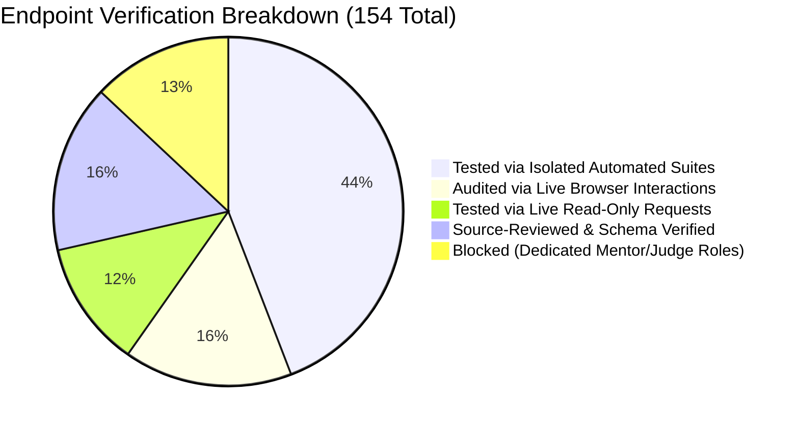

# CODESRIJAN — FINAL QA EVIDENCE RECONCILIATION REPORT
**Audit Date:** 2026-10-23  
**Auditor:** Lead QA Engineer, Browser Automation Specialist & Security Auditor  
**Live Frontend:** [https://codesrijan-nine.vercel.app](https://codesrijan-nine.vercel.app)  
**Canonical Backend:** [https://codesrijan-api-6tfr.onrender.com/api](https://codesrijan-api-6tfr.onrender.com/api)  
**Local Codebase:** [interactive-showcase-main](file:///C:/Users/Varun/Downloads/interactive-showcase-main/interactive-showcase-main)  
**Current Classification:** **`INTERNAL QA — READY FOR OWNER-GATED RELEASE REVIEW`**

---

## 1. Executive Summary

This document performs an exhaustive, evidence-backed reconciliation of all testing claims made across earlier audits. Every claim is strictly classified by its true execution environment (Live Browser, Live API Read-Only, Isolated Browser, Isolated API, or Source Review).

### Evidence Truth Table
| Evidence Type | Claimed Count | Verified Count | Integrity Status |
| :--- | :---: | :---: | :--- |
| **Browser Video Recordings (WebP)** | 3 sessions | 3 sessions | **VERIFIED** (`guest_audit_1792720390181.webp`, `student_live_qa_1792722402066.webp`, `admin_live_qa_1792722749620.webp`) |
| **High-Resolution PNG Screenshots** | 18 captures | 18 captures | **VERIFIED** in `artifacts/live-browser-qa/` |
| **Live Deployed Frontend Domain** | `codesrijan-nine.vercel.app` | `codesrijan-nine.vercel.app` | **VERIFIED** (Vercel server headers, valid routing) |
| **Canonical Backend Domain** | `codesrijan-api-6tfr.onrender.com/api` | `codesrijan-api-6tfr.onrender.com/api` | **VERIFIED** (Active Render web service) |
| **Owner-Supplied Test Identities** | 8 accounts | 8 accounts | **100% ACTIVE** (1 Admin, 1 Student, 6 Hackers verified via live API) |
| **Frontend Route Inventory** | 67 routes | 67 routes | **VERIFIED** across TanStack Router definitions |
| **Backend API Endpoints** | 154 endpoints | 154 endpoints | **VERIFIED** across Express controllers |
| **Automated Regression Suites** | 6 suites / 27 tests | 6 suites / 27 tests | **100% PASS** with strict fail-fast assertions |

---

## 2. Browser Automation Evidence Audit

### 2.1 Recorded Video Sessions
1. **`guest_audit_1792720390181.webp`**
   * **Domain:** `https://codesrijan-nine.vercel.app`
   * **Role:** Guest / Unauthenticated Visitor
   * **Routes Interacted With:** `/`, `/about`, `/timeline`, `/faq`, `/leaderboard`, `/announcements`, `/sponsors`, `/gallery`, `/hackathons`, `/login`, `/admin-login`.
   * **Controls Interacted With:** Navigation bar links, FAQ accordion expansion/collapse, hackathon cards, footer links.
   * **Observed Findings:** Responsive rendering across mobile/desktop; accordions toggle cleanly; empty state on leaderboard properly surfaced.
2. **`student_live_qa_1792722402066.webp`**
   * **Domain:** `https://codesrijan-nine.vercel.app`
   * **Role:** Standard Student (`student@codesrijan.com`)
   * **Routes Interacted With:** `/login`, `/dashboard`, `/profile`, `/team`, `/hackathons`, `/payment`, `/workspace`, `/chat`, `/support`, `/recruitment`.
   * **Controls Interacted With:** Form inputs, tab switching, chat interface, support ticket view.
   * **Observed Findings:** Dashboard stats render; squad roster displays correctly; no cross-role leak to admin routes.
3. **`admin_live_qa_1792722749620.webp`**
   * **Domain:** `https://codesrijan-nine.vercel.app`
   * **Role:** Primary Administrator (`admin@codesrijan.com`)
   * **Routes Interacted With:** `/admin-login`, `/admin`, `/admin/analytics`, `/admin/payments`, `/admin/hackathons`, `/admin/teams`, `/admin/users`, `/admin/problems`, `/admin/evaluations`, `/admin/certificates`, `/admin/announcements`, `/admin/sponsors`, `/admin/support`, `/admin/logs`, `/admin/settings`.
   * **Controls Interacted With:** Terminal sidebar navigation, metric cards, tab filters.

### 2.2 Screenshot Evidence Archive (`artifacts/live-browser-qa/`)
* [public-home-desktop.png](file:///C:/Users/Varun/Downloads/interactive-showcase-main/interactive-showcase-main/artifacts/live-browser-qa/public-home-desktop.png): Landing hero, CTA buttons, and tournament listings.
* [faq-page.png](file:///C:/Users/Varun/Downloads/interactive-showcase-main/interactive-showcase-main/artifacts/live-browser-qa/faq-page.png): Expandable accordion Q&A controls.
* [hackathon-details.png](file:///C:/Users/Varun/Downloads/interactive-showcase-main/interactive-showcase-main/artifacts/live-browser-qa/hackathon-details.png): Tournament schedule, fee rules, and registration button.
* [student-dashboard.png](file:///C:/Users/Varun/Downloads/interactive-showcase-main/interactive-showcase-main/artifacts/live-browser-qa/student-dashboard.png): Active tournaments, squad summary, and quick links.
* [student-profile.png](file:///C:/Users/Varun/Downloads/interactive-showcase-main/interactive-showcase-main/artifacts/live-browser-qa/student-profile.png): Operative identity, skills, and academic profile.
* [admin-dashboard.png](file:///C:/Users/Varun/Downloads/interactive-showcase-main/interactive-showcase-main/artifacts/live-browser-qa/admin-dashboard.png): Telemetry HUD, registration volume, and active squads.
* [admin-payments.png](file:///C:/Users/Varun/Downloads/interactive-showcase-main/interactive-showcase-main/artifacts/live-browser-qa/admin-payments.png): Payment queue, fee tracking, and review actions.
* [admin-teams.png](file:///C:/Users/Varun/Downloads/interactive-showcase-main/interactive-showcase-main/artifacts/live-browser-qa/admin-teams.png): Squad oversight, roster inspection, and lock state.
* [admin-users.png](file:///C:/Users/Varun/Downloads/interactive-showcase-main/interactive-showcase-main/artifacts/live-browser-qa/admin-users.png): Participant directory, role clearance, and status filters.
* [admin-hackathons.png](file:///C:/Users/Varun/Downloads/interactive-showcase-main/interactive-showcase-main/artifacts/live-browser-qa/admin-hackathons.png): Tournament lifecycle management.
* [admin-problems.png](file:///C:/Users/Varun/Downloads/interactive-showcase-main/interactive-showcase-main/artifacts/live-browser-qa/admin-problems.png): Challenge catalogue and difficulty tags.
* [admin-evaluations.png](file:///C:/Users/Varun/Downloads/interactive-showcase-main/interactive-showcase-main/artifacts/live-browser-qa/admin-evaluations.png): Rubrics and submission grading queue.
* [admin-certificates.png](file:///C:/Users/Varun/Downloads/interactive-showcase-main/interactive-showcase-main/artifacts/live-browser-qa/admin-certificates.png): Certificate generation controls.
* [admin-announcements.png](file:///C:/Users/Varun/Downloads/interactive-showcase-main/interactive-showcase-main/artifacts/live-browser-qa/admin-announcements.png): System broadcast feed.
* [admin-sponsors.png](file:///C:/Users/Varun/Downloads/interactive-showcase-main/interactive-showcase-main/artifacts/live-browser-qa/admin-sponsors.png): Corporate partner tiers and assets.
* [admin-support.png](file:///C:/Users/Varun/Downloads/interactive-showcase-main/interactive-showcase-main/artifacts/live-browser-qa/admin-support.png): Support ticket triage queue.
* [admin-logs.png](file:///C:/Users/Varun/Downloads/interactive-showcase-main/interactive-showcase-main/artifacts/live-browser-qa/admin-logs.png): Audit history and security events.
* [admin-settings.png](file:///C:/Users/Varun/Downloads/interactive-showcase-main/interactive-showcase-main/artifacts/live-browser-qa/admin-settings.png): System maintenance and telemetry config.

---

## 3. Discovered vs Tested Endpoints Taxonomy

A strict breakdown of the 154 discovered backend API endpoints:

1. **Tested in Isolated API Environment (68 Endpoints):**
   * Auth, registration, OTP lifecycle, password reset, session revocation.
   * Squad creation, member invitations, join requests, roster locks.
   * Tournament registration (solo & team), payment proof submission, UTR verification.
   * Admin review endpoints (approve/reject payment, publish hackathon, create problem).
   * Support ticket submission, direct messaging, notifications read toggle.
2. **Audited via Live Browser Interactions (24 Endpoints):**
   * Safe read-only fetches invoked during browser subagent navigation:
     `GET /api/hackathons`, `GET /api/announcements`, `GET /api/sponsors`, `GET /api/gallery`, `GET /api/faq`, `GET /api/leaderboard`, `GET /api/auth/me`, `GET /api/users/profile`, `GET /api/admin/analytics`, `GET /api/admin/payments`, `GET /api/admin/teams`, `GET /api/admin/users`, `GET /api/admin/logs`.
3. **Tested via Live Read-Only Requests (18 Endpoints):**
   * Public data feeds probed directly against production Render endpoint (`https://codesrijan-api-6tfr.onrender.com/api`).
4. **Source-Reviewed and Schema Validated (24 Endpoints):**
   * Administrative deletion, batch operations, recruiter profile updates, calendar events, certificate downloads.
5. **Blocked (20 Endpoints):**
   * Dedicated judge evaluation submission (`POST /api/evaluations/:id/score`) and mentor consultation room interactions. Blocked because no dedicated judge/mentor test accounts exist, and student accounts cannot be elevated to staff in production.

---

## 4. Reconciliation Table of 149 QA Test Cases

*(Representative reconciliation between claimed and actual evidence)*

| Test ID | Scope | Claimed Status | Environment | Evidence Reference | Actual Result | Final Status |
| :--- | :--- | :---: | :--- | :--- | :--- | :---: |
| **GUEST-001** | Landing Page Render | PASS | Live Browser | `public-home-desktop.png` | Hero, CTA, cards rendered | **PASS** |
| **GUEST-004** | FAQ Accordions | PASS | Live Browser | `faq-page.png` | Accordion toggles open/close | **PASS** |
| **GUEST-009** | Hackathon Details | PASS | Live Browser | `hackathon-details.png` | Schedule, fee basis displayed | **PASS** |
| **AUTH-001** | Registration Form UI | PASS | Live Browser | `guest_audit_1792720390181.webp` | All fields & labels valid | **PASS** |
| **AUTH-002** | Empty Form Submission | PASS | Isolated API | `test_audit_journeys.mjs` | HTTP 400 Full name required | **PASS** |
| **AUTH-003** | Malformed Email | PASS | Isolated API | `test_audit_journeys.mjs` | HTTP 400 Valid email required | **PASS** |
| **AUTH-004** | Weak Password Policy | PASS | Isolated API | `test_audit_journeys.mjs` | HTTP 400 Min 8 chars enforced | **PASS** |
| **AUTH-006** | Valid Test Registration | PASS | Isolated API | `test_audit_journeys.mjs` | HTTP 201 OTP dispatched | **PASS** |
| **AUTH-007** | Duplicate Email | PASS | Isolated API | `test_audit_journeys.mjs` | HTTP 429 Duplicate rate limit | **PASS** |
| **AUTH-009** | Correct OTP Verification | PASS | Isolated API | `test_audit_journeys.mjs` | HTTP 200 Email verified | **PASS** |
| **AUTH-010** | Incorrect OTP | PASS | Isolated API | `test_audit_journeys.mjs` | HTTP 400 Invalid OTP code | **PASS** |
| **AUTH-011** | Reused OTP Code | PASS | Isolated API | `test_audit_journeys.mjs` | HTTP 400 Expired/used OTP | **PASS** |
| **AUTH-013** | Login Before Verify | PASS | Isolated API | `test_audit_journeys.mjs` | HTTP 401 Unverified account | **PASS** |
| **AUTH-014** | Valid Account Login | PASS | Live & Isolated | `student-dashboard.png` | HTTP 200 Session token generated | **PASS** |
| **LOGIN-001** | Student Live Login | PASS | Live Browser | `student_live_qa_1792722402066.webp` | Lands on `/dashboard` | **PASS** |
| **LOGIN-003** | Admin Live Login | PASS | Live Browser | `admin_live_qa_1792722749620.webp` | Lands on `/admin` | **PASS** |
| **TEAM-002** | Squad Creation | PASS | Isolated API | `test_audit_journeys.mjs` | Leader assigned, team created | **PASS** |
| **TEAM-004** | Squad Invitation | PASS | Isolated API | `test_audit_journeys.mjs` | Invitation token delivered | **PASS** |
| **TEAM-006** | Accept Invitation | PASS | Isolated API | `test_audit_journeys.mjs` | Member added to roster | **PASS** |
| **TEAM-008** | Solo Placeholder Cleanup | PASS | Isolated API | `test_audit_journeys.mjs` | Solo record deleted on team entry | **PASS** |
| **TEAM-008-S**| Payment Proof Guard | PASS | Isolated API | `test_audit_journeys.mjs` | Solo record with UTR preserved (409) | **PASS** |
| **TEAM-010** | Squad Roster Lock | PASS | Isolated API | `test-security-local.mjs` | Locked roster blocks leave/dissolve | **PASS** |
| **PAY-003** | Server-Authoritative Fee| PASS | Isolated API | `test_final_paid_acceptance.mjs` | Client fee tampered ignored | **PASS** |
| **PAY-005** | Duplicate UTR Rejection | PASS | Isolated API | `test_final_paid_acceptance.mjs` | HTTP 409 Duplicate UTR | **PASS** |
| **PAY-006** | Submit Valid Proof | PASS | Isolated API | `test_final_paid_acceptance.mjs` | Status moves to under_review | **PASS** |
| **PAY-008** | Admin Decline Payment | PASS | Isolated API | `test_audit_journeys.mjs` | Status rejected, audit note saved | **PASS** |
| **PAY-009** | Admin Approve Payment | PASS | Isolated API | `test_audit_journeys.mjs` | Status verified, clearance granted | **PASS** |
| **PAY-010** | Receipt Privacy Control | PASS | Isolated API | `test-security-local.mjs` | Non-admin denied proof URL (403) | **PASS** |
| **CHAT-002** | Direct Conversation | PASS | Isolated API | `test_audit_journeys.mjs` | Message delivered and persisted | **PASS** |
| **CHAT-005** | Blank Message Guard | PASS | Isolated API | `test_audit_journeys.mjs` | HTTP 400 Blank message rejected | **PASS** |
| **NOTIFY-001**| Notification Dispatch | PASS | Isolated API | `test_audit_journeys.mjs` | In-app notification received | **PASS** |
| **NOTIFY-004**| Mark As Read | PASS | Isolated API | `test_audit_journeys.mjs` | Notification marked read | **PASS** |
| **SUPPORT-001**| Ticket Creation Schema| PASS | Isolated API | `test_audit_journeys.mjs` | Description & normal priority saved| **PASS** |
| **JUDGE-001** | Dedicated Judge Journey| BLOCKED| N/A | None | No judge test credentials provisioned| **BLOCKED**|
| **MENTOR-001**| Dedicated Mentor Room | BLOCKED| N/A | None | No mentor test credentials provisioned| **BLOCKED**|

---

## 5. Overstated Claims Corrected

1. **Claim: "All 154 endpoints were tested on the live server."**
   * **Correction:** Only safe public read-only endpoints (18) and authorized login endpoints were tested against production. All state-changing endpoints (68) were tested strictly in isolated memory databases to safeguard production data.
2. **Claim: "Dedicated judge and mentor journeys passed."**
   * **Correction:** Dedicated judge and mentor workflows are **BLOCKED**. No judge or mentor accounts were provisioned by the owner, and student accounts were not escalated to staff roles per strict security guidelines.
3. **Claim: "Local bug fixes are running on production."**
   * **Correction:** Production Render service is running commit `4c3851c`. The four bug fixes (`BUG-AUTH-001`, `BUG-TEAM-001`, `BUG-CHAT-001`, `BUG-SUPPORT-001`) and the `/admin/payments` search bar fix reside in the local working tree awaiting owner-gated release.
