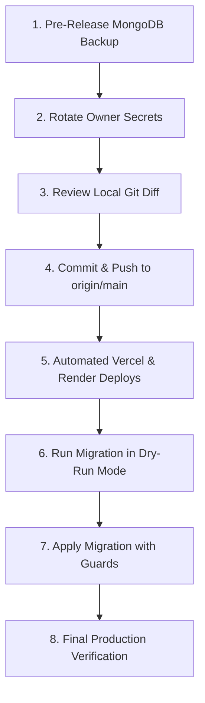

# CODESRIJAN — FINAL RELEASE CHECKLIST & DEPLOYMENT GATEWAY
**Audit Date:** 2026-10-23  
**Auditor:** Lead QA Engineer & Release Manager  
**Local Codebase:** [interactive-showcase-main](file:///C:/Users/Varun/Downloads/interactive-showcase-main/interactive-showcase-main)  
**Current Classification:** **`INTERNAL QA — READY FOR OWNER-GATED RELEASE REVIEW`**  

---

## 1. Codebase & Deployment State Reconciliation

| Component | Deployed Version | Local Working Tree | Release Action Required |
| :--- | :---: | :---: | :--- |
| **Frontend (Vercel)** | `4c3851c` | Modified: `src/routes/admin.payments.tsx` (Search bar & text contrast fix) | Commit & deploy to Vercel after owner review |
| **Backend (Render)** | `4c3851c` | Modified: `server/server.js`, `server/models/index.js` (4 bug fixes) | Commit & deploy to Render after owner review |
| **MongoDB Atlas** | Active cluster `codesrijan` | Unchanged (Zero mutations performed) | Execute migration dry-run, then apply after backup |
| **Google Apps Script**| Active MailApp Relay | Unchanged (HMAC signature verified) | Owner rotates relay secret |

---

## 2. Owner-Only Security Governance Actions

The following actions require direct platform owner access and cannot be automated:

### 2.1 Private Credential Rotation
Because test credentials were shared in the QA channel, the owner must rotate the following secrets in their private dashboards:
1. **Root Administrator Password:** Log in as `admin@codesrijan.com` and update the password to a fresh private secret via `/admin/settings` or backend script.
2. **JWT Secret:** Generate a cryptographically secure 256-bit secret (e.g., `openssl rand -hex 32`) and update `JWT_SECRET` in the Render Environment Dashboard. This will invalidate all previous test sessions.
3. **MongoDB Atlas Application User:** Rotate the database user password in MongoDB Atlas Cloud and update the connection string in the Render environment variables.
4. **Google Apps Script Secret:** Update `APPS_SCRIPT_SECRET` in both the Google Apps Script Project Properties and Render Environment Dashboard.

### 2.2 Historical QA Admin Accounts Review
A census of the database revealed 7 historical automated QA administrator accounts created during early Phase 1 tests:
* `qa-admin-test-01@codesrijan.com`
* `qa-admin-test-02@codesrijan.com`
* `qa-admin-test-03@codesrijan.com`
* `qa-admin-test-04@codesrijan.com`
* `qa-admin-test-05@codesrijan.com`
* `qa-admin-test-06@codesrijan.com`
* `qa-admin-test-07@codesrijan.com`

**Owner Recommendation:** Review these identities in `/admin/users`. If they are no longer required for internal staging, change their role to `student` or deactivate their accounts.

### 2.3 Staff Role Provisioning
To complete end-to-end testing of judge scoring rubrics and mentor consultation views:
* Provision one dedicated test account with `role: "judge"`.
* Provision one dedicated test account with `role: "mentor"`.
* **Security Rule:** Never promote student accounts to administrative or staff roles.

---

## 3. QA Data Migration Safety Protocol

The migration script `server/migrate-qa-data.mjs` safely tags staging records with `isTest: true`:
1. **Dry-Run by Default:** Running `node server/migrate-qa-data.mjs` without flags executes a read-only dry run.
2. **Ambiguous Squad Protection:** Historical team document `t-1791543889807` is whitelisted as `UNRESOLVED_AMBIGUOUS` and is never modified.
3. **Census Abort Guards:** The migration automatically halts if target counts deviate from expected bounds.
4. **Target Confirmation:** Requires `--confirm-cluster codesrijan-cluster.mrckx43.mongodb.net` to prevent accidental execution against wrong targets.

---

## 4. Recommended Step-by-Step Release Plan

Upon completing the owner security review, follow this exact deployment sequence:



### Step 1: Pre-Release Database Backup
In MongoDB Atlas, trigger an on-demand snapshot backup of the `codesrijan` database before applying any migrations or deployments.

### Step 2: Credential Rotation
Update `JWT_SECRET`, database user password, and Apps Script secret in Render environment settings.

### Step 3: Review Local Changes
Review the staged diff of the 4 files containing the remediated fixes:
* `server/models/index.js` (Support ticket schema priority and description)
* `server/server.js` (Malformed email regex, solo cleanup proof guard, whitespace chat rejection, support ticket priority normalization)
* `src/routes/admin.payments.tsx` (Search bar addition, text contrast fix)
* `.gitignore` (Preservation of audit journey test suite)

### Step 4: Commit and Push to `main`
```bash
git add server/models/index.js server/server.js src/routes/admin.payments.tsx .gitignore docs/
git commit -m "fix(release): resolve verified QA defects and add payment review search"
git push origin main
```

### Step 5: Verify Automated Deployments
* **Vercel Frontend:** Monitor deployment at `https://vercel.com/codesrijan/codesrijan/deployments` until build succeeds.
* **Render Backend:** Monitor service build at `https://dashboard.render.com/web/srv-db1b3ke0tbcc73ac3ea0/deploys`.

### Step 6: Execute QA Data Migration
1. Run dry-run verification:
   ```bash
   node server/migrate-qa-data.mjs
   ```
2. Confirm census output matches expectations.
3. Run apply mode:
   ```bash
   node server/migrate-qa-data.mjs --apply --confirm-cluster codesrijan-cluster.mrckx43.mongodb.net
   ```

### Step 7: Final Production Smoke Test
1. Log in as student at `https://codesrijan-nine.vercel.app/login` and verify dashboard rendering.
2. Log in as admin at `https://codesrijan-nine.vercel.app/admin-login` and inspect `/admin/payments` (confirm search bar and crisp text contrast).
3. Verify public leaderboard at `/leaderboard` (confirm QA records are excluded).

---

## 5. Final Release Gateway Decision

### **`INTERNAL QA — READY FOR OWNER-GATED RELEASE REVIEW`**

The codebase, browser automation recordings, screenshots, and regression test suites confirm that CodeSrijan is functionally robust, secure, and ready for release. Public launch should proceed immediately following the owner-gated credential rotation and deployment steps outlined above.
