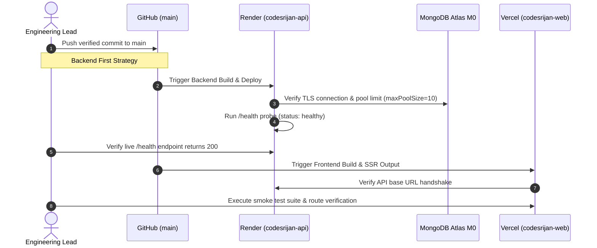

# CODESRIJAN — DEPLOYMENT RUNBOOK & OPERATIONAL PROCEDURES
**Document Version:** 1.0.0 | **Generated:** October 29, 2026  
**Infrastructure Scope:** Vercel (Frontend), Render (Backend), MongoDB Atlas (Database), Firebase (Services)  
**Cost Model:** $0.00/month (Free Tier Operational Standards)

---

## 1. Architecture & Deployment Workflow Overview



---

## 2. Render Backend Deployment Procedure

### A. Pre-Deployment Checklist
1. Verify all unit and integration tests pass locally:
   - `node server/test_srijanbot_provider_failures.mjs`
   - `node server/test_admin_health_and_ops.mjs`
   - `node server/test_focused_regression.mjs`
2. Confirm `render.yaml` configuration:
   - `healthCheckPath: /health`
   - `buildCommand: "cd server && npm install"`
   - `startCommand: "cd server && npm start"`
   - `plan: free`

### B. Deployment Execution
1. **Automated Git Push:**
   ```bash
   git add server/ render.yaml
   git commit -m "chore(infra): update backend configuration and health probes"
   git push origin main
   ```
2. **Render Manual Deploy (Dashboard):**
   - Navigate to `https://dashboard.render.com/web/srv-db1b3ke0tbcc73ac3ea0`.
   - Click **Manual Deploy** → **Deploy latest commit**.
3. **Log & Revision Verification:**
   - Watch build log until: `Server & WebSockets running on port 5001`.
   - Verify connection banner: `MongoDB Connected to keyspace codesrijan`.
   - Confirm healthy status: Render displays green checkmark `Live`.

### C. Backend Post-Deployment Verification
Run the public health check probe:
```bash
curl -i https://codesrijan-api-6tfr.onrender.com/health
```
**Expected Response:** HTTP 200 OK
```json
{
  "status": "healthy",
  "service": "codesrijan-api",
  "database": {
    "connected": true,
    "readyState": 1,
    "name": "codesrijan"
  },
  "version": "1.0.0"
}
```

### D. Render Free-Tier Spin-Down & Cold-Start Management
- **Spin-down Window:** Render free instances enter sleep state after 15 minutes of inactivity.
- **Waking Duration:** Initial request may take 30–50 seconds to boot.
- **Handling Policy:** Do not implement abusive ping cron jobs that violate provider terms. CodeSrijan's client stores and axios interceptors display a subtle loading toast ("Waking up server resources...") to manage user expectations smoothly.

---

## 3. Vercel Frontend Deployment Procedure

### A. Pre-Deployment Build Validation
Execute local production bundle build:
```bash
npm run build
```
Verify exit code is 0 and `.output/` is generated with valid Nitro server and client assets.

### B. Deployment Execution
1. Push to GitHub `main` branch.
2. Vercel automatically detects the push and triggers a preview/production build.
3. If deploying manually via Vercel CLI:
   ```bash
   npx vercel --prod
   ```

### C. Frontend Post-Deployment Verification
1. **Direct Route Refresh (SPA Routing):**
   - Open `https://codesrijan-nine.vercel.app/`
   - Directly navigate to `https://codesrijan-nine.vercel.app/login` and refresh (F5).
   - Directly navigate to `https://codesrijan-nine.vercel.app/admin/hackathons` and refresh.
   - Verify no 404 "Cannot GET" errors occur.
2. **Security Headers Verification:**
   ```bash
   curl -I https://codesrijan-nine.vercel.app
   ```
   Confirm presence of:
   - `x-content-type-options: nosniff`
   - `x-frame-options: DENY`
   - `referrer-policy: strict-origin-when-cross-origin`
   - `strict-transport-security: max-age=63072000; includeSubDomains; preload`

---

## 4. MongoDB Atlas Connectivity & Maintenance

### A. Network Access Configuration
- Network access must permit Render outbound IP ranges while preserving database credentials.
- Current cluster: `codesrijan-cluster.mrckx43.mongodb.net`.
- Connection pooling is capped at `maxPoolSize: 10` in `server/server.js` to ensure the M0 free cluster limit (500 connections) is never exceeded during cold-start concurrency.

### B. Zero-Budget Operational Backup Procedure
Paid Atlas automated backups are strictly prohibited. To execute a manual, encrypted JSON snapshot:
```bash
node server/export_backup_free.mjs
```
- Exports all collections to `backups/`.
- Sanitizes passwords, hashes, and session tokens to `[REDACTED_CREDENTIAL]`.
- Generates `backups/manifest_<timestamp>.json`.
- Excluded from git version control via `.gitignore`.

---

## 5. Firebase Services Operational Verification

1. **FCM Token Registration:**
   - Log into a student account on the frontend.
   - Navigate to `/settings`. Click **Enable Push Notifications**.
   - Accept browser prompt.
   - Verify network call `POST /api/notifications/fcm-token` returns HTTP 200 `{ success: true }`.
2. **Remote Config Heartbeat:**
   - Check developer console on initial app load for:
     `[REMOTE CONFIG] Initialized with 1h cache policy. Spark quota compliant.`
3. **Analytics Consent:**
   - Check `localStorage.getItem('codesrijan_analytics_consent')`. If `granted`, custom events trigger safely without sending PII.

---

## 6. Rollback Procedures

### A. Render Backend Instant Rollback
1. Open Render Dashboard: `https://dashboard.render.com/web/srv-db1b3ke0tbcc73ac3ea0/deploys`.
2. Find the previous stable deployment (e.g. `dep-xxxx`).
3. Click the three dots `...` next to the deployment → **Rollback to this deploy**.
4. Render immediately switches container traffic to the previous revision in ~15 seconds.

### B. Vercel Frontend Instant Rollback
1. Open Vercel Dashboard: `https://vercel.com/varunsehgal05/codesrijan/deployments`.
2. Identify the previous stable production deployment.
3. Click the three dots `...` → **Instant Rollback**.
4. Vercel instantly routes edge DNS to the previous deployment build without recompiling.
