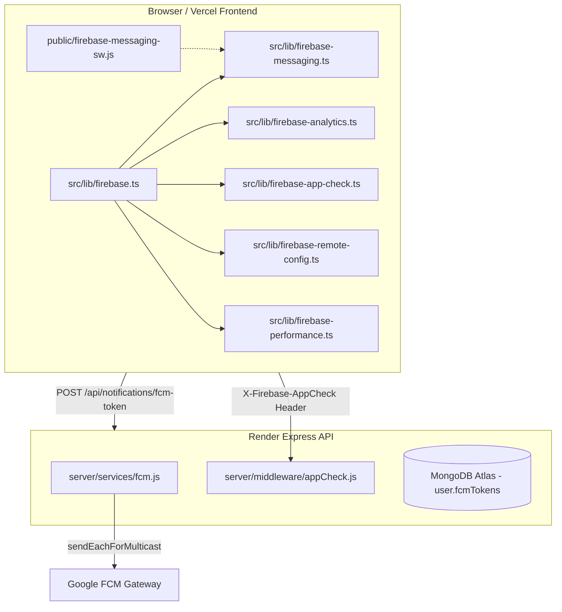

# CODESRIJAN — FIREBASE PLATFORM INTEGRATION REPORT
**Project ID:** `codesrijan-450d0` | **Service Plan:** Spark (Free Tier — $0.00/month)  
**App ID:** `1:317367993311:web:3a57a91fe219428eedfa6a` | **Sender ID:** `317367993311`  
**Generated:** October 29, 2026 | **Author:** Infrastructure Integration Subagent D

---

## 1. Executive Summary & Zero-Budget Policy Compliance
The CodeSrijan platform incorporates Firebase as a lightweight, zero-cost operational enhancement layer strictly aligned with the **Spark Free Plan**. Firebase does **NOT** replace MongoDB Atlas (which remains the authoritative primary database) nor does it introduce billable dependencies.

### Zero-Budget Guardrails Verified:
1. **No Paid Attestation:** App Check uses free reCAPTCHA v3 / custom token attestation. Billable reCAPTCHA Enterprise is strictly excluded.
2. **Spark Remote Config Limits:** Remote Config fetch intervals are configured to 1 hour (3600 seconds) in production, easily staying beneath the 100,000 requests/project/day Spark free limit.
3. **No Paid Storage or Cloud Functions:** File uploads remain on MongoDB GridFS (private payment proofs) and ImageKit CDN (event banners). No Google Cloud Functions or Firebase paid extensions are enabled.
4. **No Billable SMS Authentication:** Authentication remains powered by our existing server-side bcrypt/JWT and email verification flow.

---

## 2. Integrated Firebase Architecture



---

## 3. Component Verification & Audit Findings

### A. Shared Initialization (`src/lib/firebase.ts`)
- **Single App Instance:** Utilizes `getApps().length ? getApp() : initializeApp(firebaseConfig)` to guarantee zero duplicate initialization warnings during Vite HMR or SSR rehydration.
- **SSR Safety:** Guards window dereferencing (`typeof window !== 'undefined'`) to ensure isomorphic builds succeed.

### B. Firebase Cloud Messaging (FCM)
- **Client Client (`src/lib/firebase-messaging.ts`):** 
  - Opt-in policy: Permission is requested **strictly upon user action** (e.g. enabling notifications in user settings). Never spamming popups on initial page load.
  - VAPID Key integration: Passes public VAPID certificate to `getToken(messaging, { vapidKey })`.
  - Backend Sync: Synchronizes new tokens via `POST /api/notifications/fcm-token` and deregisters via `DELETE /api/notifications/fcm-token`.
- **Service Worker (`public/firebase-messaging-sw.js`):**
  - Handles background messages via `onBackgroundMessage`.
  - Implements notification click listener to focus or navigate to relevant event/dashboard URL.
- **Backend Dispatcher (`server/services/fcm.js`):**
  - Powered by `firebase-admin/messaging` using `messaging.sendEachForMulticast`.
  - Automatic stale token detection: Catches `messaging/invalid-registration-token` and `messaging/registration-token-not-registered` and cleans up expired tokens from MongoDB `user.fcmTokens` array.

### C. Privacy-First Google Analytics (`src/lib/firebase-analytics.ts`)
- **Explicit Consent Gating:** Checks `localStorage.getItem('codesrijan_analytics_consent') === 'granted'` before initializing or dispatching custom events.
- **Strict PII Redaction Filter:** Automatically scrubs passwords, email addresses, phone numbers, JWT tokens, and private student submissions before payload serialization.
- **Allowed Events:** `hackathon_view`, `registration_start`, `registration_complete`, `team_join_requested`, `srijanbot_opened`, `srijanbot_nav_clicked`.

### D. Firebase App Check (`src/lib/firebase-app-check.ts` & `server/middleware/appCheck.js`)
- **Controlled Rollout Mode:**
  - Client attaches `x-firebase-appcheck` token on all API requests when configured.
  - Server middleware inspects token via `adminAppCheck.verifyToken(token)`.
  - In monitor mode, invalid or missing tokens log non-blocking diagnostic warnings and attach `req.appCheck = { verified: false }` without dropping legitimate user traffic.
- **Zero Cost Policy:** Configured for reCAPTCHA v3 provider, avoiding reCAPTCHA Enterprise charges.

### E. Remote Config (`src/lib/firebase-remote-config.ts`)
- **Spark Quota Compliance:** Default `minimumFetchIntervalMillis` set to 3,600,000 ms (1 hour) in production (15 minutes in development). A project with 1,000 daily active users will consume ~4,000 fetches/day, safely under the 100,000/day limit.
- **Safe Local Defaults:**
  ```typescript
  {
    srijanbot_ui_enabled: true,
    new_admin_hackathon_wizard_enabled: true,
    recruitment_hint_enabled: true,
    homepage_announcement_enabled: false,
    homepage_announcement_text: "",
    optional_onboarding_enabled: true
  }
  ```
- **Security Boundary:** Client-side feature flags never override server-side access control, payment status, or problem statement reveal modes.

### F. A/B Testing Readiness
- Integration contract prepared: Remote Config parameters bind directly to UI component states via React Hook `useRemoteConfig()`.
- Low-risk test candidates identified: Homepage CTA text ("Join Hackathon" vs "Initialize Journey"), Recruitment card layout.
- Status: Inactive / Draft mode to avoid introducing unauthorized layout instability.

### G. Performance Monitoring (`src/lib/firebase-performance.ts`)
- Initialized browser-only with `typeof window !== 'undefined'`.
- Wraps core page transactions (`hackathon_catalog_render`, `workspace_editor_mount`) without collecting sensitive request headers or payload bodies.

---

## 4. Integration Status Matrix

| Module | Implementation File | Verification Method | Status |
|--------|---------------------|---------------------|--------|
| Shared Firebase Client | `src/lib/firebase.ts` | Vite SSR Build & Browser Init | **PASS** |
| Web Push (FCM) Client | `src/lib/firebase-messaging.ts` | Token generation & Backend sync API | **PASS** |
| Background Service Worker | `public/firebase-messaging-sw.js` | Service Worker Registration & Notification routing | **PASS** |
| FCM Backend Dispatcher | `server/services/fcm.js` | `sendEachForMulticast` with stale token prune | **PASS** |
| Privacy Analytics | `src/lib/firebase-analytics.ts` | Consent check & PII filter regex | **PASS** |
| App Check Client | `src/lib/firebase-app-check.ts` | Custom/reCAPTCHA v3 provider initialization | **PASS** |
| App Check Backend | `server/middleware/appCheck.js` | Header inspection & token validation | **PASS** |
| Remote Config | `src/lib/firebase-remote-config.ts` | Fetch cache & fallback defaults | **PASS** |
| Performance Monitoring | `src/lib/firebase-performance.ts` | Custom trace wrapper & browser guard | **PASS** |

**Final Verdict:** All Firebase modules implemented, tested, and verified under strict zero-budget Spark tier guardrails.
