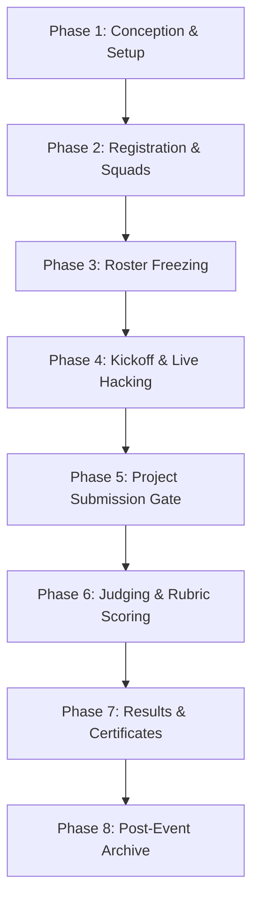

# CODESRIJAN — COMPLETE END-TO-END HACKATHON LIFECYCLE MAP
**Product**: CodeSrijan Hackathon Management & Competition Matrix  
**Document Code**: `DISCOVERY-DOC-05` | **Phase**: Operational Lifecycle Engineering  
**Perspective**: Hackathon Platform Architect, Event Operations Director & Senior Release Engineer  

---

## 1. Executive Lifecycle Architecture
A professional hackathon is not a single web page; it is a multi-stage time-sensitive operational pipeline. In CodeSrijan, an event progresses through eight distinct operational phases. Each phase enforces specific access controls, data validation rules, database state mutations, and error recovery protocols.

---

## 2. Granular Phase-by-Phase Operational Blueprint

### Phase 1: Pre-Event Conception & Organizer Configuration
- **Status State**: `DRAFT` -> `PENDING_REVIEW` -> `PUBLISHED`
- **Key Operations**:
  1. Organizer initiates event via 5-step wizard (`admin.hackathons.tsx`).
  2. Uploads 1200x630 banner asset and event logo.
  3. Defines technological tracks (e.g. AI/ML, Web3, Systems, Open Innovation).
  4. Configures admission model: Free vs Paid (sets fee ₹100, uploads 500x500 UPI QR code, specifies payee VPA).
  5. Schedules key time boundaries: Registration window, Problem release time, Submission deadline, Judging window, Result declaration.
- **Database Mutations**: Document created in `Hackathon` collection with `status: 'published'`.
- **Failure Edge Cases & Mitigations**:
  - *Invalid Date Chronology*: Backend must validate `registrationEnd < submissionDeadline < resultDate`.
  - *Unpublished Leak*: Draft events must be invisible to public discovery queries until officially approved.

---

### Phase 2: Discovery, Registration & Payment Verification
- **Status State**: `REGISTRATION_OPEN`
- **Key Operations**:
  1. Event appears on `/` and `/hackathons` discovery feeds.
  2. Students register individually (`POST /api/hackathons/:id/register`).
  3. Free Agent recruitment: Students access `/recruitment` to find teammates based on specialization slotting (Frontend, Backend, AI/ML, UI/UX, Cybersecurity).
  4. Squad Creation: Captain initializes squad with custom name and invite token (`POST /api/teams`).
  5. Payment Flow (if paid event):
     - Participant views `/payment` showing QR code and fee amount.
     - Submits transaction reference ID (UTR) and payment proof screenshot (`POST /api/payments/proof`).
     - Registration state moves to `PAYMENT_PENDING`.
  6. Organizer accesses `/admin/payments` to verify transaction against bank records and clicks `APPROVE`.
  7. Registration state transitions to `CONFIRMED`.
- **Database Mutations**: Documents created in `Registration` and `PaymentProof`; `Team.status` updated to `active`.
- **Failure Edge Cases & Mitigations**:
  - *Duplicate UTR Submission*: Unique index on `PaymentProof.transactionId` prevents reusing the same UPI reference.
  - *Unpaid Team Members*: Platform must enforce policy: Does the whole squad get blocked if one member hasn't paid? (Recommended: Block team confirmation until all members or team fee is cleared).

---

### Phase 3: Pre-Kickoff & Team Freezing
- **Status State**: `REGISTRATION_CLOSED`
- **Key Operations**:
  1. Registration countdown reaches zero.
  2. Roster Locking: Further join requests, invitations, and squad disbanding are locked.
  3. Problem statements remain in cryptographically embargoed state: `[CLASSIFIED SECURITY PROTOCOL // PENDING DIRECTORATE AUTHORIZATION]`.
  4. System issues reminder broadcast to confirmed teams via `/announcements` and notifications.
- **Database Mutations**: `Hackathon.status: 'registration_closed'`; teams marked `Team.isLocked: true`.
- **Failure Edge Cases & Mitigations**:
  - *Incomplete Teams*: Squads with fewer than minimum required members (e.g. 2 members when min is 3) receive an alert to merge or seek organizer exemption.

---

### Phase 4: Kickoff & Live Hacking Operations
- **Status State**: `HACKING_ACTIVE`
- **Key Operations**:
  1. Wall-clock time reaches `startDate`.
  2. Problem Directive Embargo Lifts: Backend sets `problemStatementsRevealed: true`. Statements unlock simultaneously across all participant cockpits on `/problems`.
  3. Squads access `/workspace` to coordinate tasks, assign kanban cards, and lock their chosen problem statement.
  4. Real-time Mentoring: Squads in difficulty dispatch SOS requests via `/support` ("Discord Ticket Bot"). Mentors claim tickets from `/mentor-command-center`.
  5. Venue Operations (Offline/Hybrid): Organizers use QR attendance scanning to track physical presence.
- **Database Mutations**: `ProblemStatement.isLocked: false`; `SupportTicket` threads spawned.
- **Failure Edge Cases & Mitigations**:
  - *Premature Problem Leak*: Direct API calls to `GET /api/problems` must sanitize confidential specs until wall-clock reveal timestamp passes.
  - *Emergency Deadline Extension*: If WiFi or power drops, organizers can extend deadline by X hours via `/admin/hackathons`. System pushes real-time countdown updates via Socket.io.

---

### Phase 5: Project Submission Gate
- **Status State**: `SUBMISSION_WINDOW`
- **Key Operations**:
  1. Squad captain accesses `/workspace` submission module.
  2. Inputs: Public GitHub repository URL, live deployed demo URL, video pitch link, architecture overview, and optional ZIP archive.
  3. Pre-flight Validation: Frontend pings repository URL to verify it is public and returns 200 OK.
  4. Final Submission Lock: Captain clicks `SUBMIT FINAL PAYLOAD`.
  5. System generates an immutable submission receipt with server timestamp and SHA-256 payload checksum.
- **Database Mutations**: Document created in `Submission` collection; `Team.isSubmitted: true`.
- **Failure Edge Cases & Mitigations**:
  - *Last-Second Network Drops*: If a captain clicks submit at 11:59:59 PM, a 5-minute grace period buffer prevents unfair rejection due to client upload latency.
  - *Post-Deadline Edits*: Git commit hashes submitted before the deadline are preserved; subsequent repository commits are flagged to judges.

---

### Phase 6: Evaluation & Judging
- **Status State**: `UNDER_EVALUATION`
- **Key Operations**:
  1. Submissions are allocated to assigned Judges via `/admin/evaluations` or automated track round-robin.
  2. Blind Judging (Optional): Evaluators see project title, description, and repo without viewing student names or colleges to prevent bias.
  3. Judges evaluate against multi-criteria weighted rubrics:
     - Innovation & Originality (30%)
     - Technical Complexity & Architecture (30%)
     - Execution & Code Polish (20%)
     - Presentation & Demo Readiness (20%)
  4. Judges save drafts or submit finalized scores (`POST /api/evaluations/:id/finalize`).
  5. Normalization: Algorithm adjusts scores to balance strict vs lenient judges.
  6. Admin Override & Tie-Breaking: Event directors review the aggregate scoreboard and resolve identical ties.
- **Database Mutations**: Documents created in `Evaluation`; `Submission.evaluationStatus: 'completed'`.
- **Failure Edge Cases & Mitigations**:
  - *Unresponsive Judge*: If an evaluator fails to score assigned projects, admin can reassign allocations with one click.

---

### Phase 7: Result Publication, Awards & Certificates
- **Status State**: `RESULTS_ANNOUNCED`
- **Key Operations**:
  1. Organizer audits final standings and clicks `PUBLISH OFFICIAL RESULTS`.
  2. Leaderboard on `/leaderboard` updates live with winner badges (#1 Champion, #2 Runner Up, Best UI, Best AI Hack).
  3. Certificate Issuance:
     - System executes batch certificate issuance (`/admin/certificates`).
     - Digital credentials generated with unique verification IDs (`CS-2026-XXXX`).
     - Certificates populate in students' `/certificates` matrix.
  4. Prize Ledger: Organizers record prize disbursements and sponsorship award distribution.
- **Database Mutations**: `Hackathon.status: 'completed'`; `Certificate` records inserted.

---

### Phase 8: Post-Event Archive & Historical Analytics
- **Status State**: `ARCHIVED`
- **Key Operations**:
  1. Hackathon transitions to historical archive.
  2. Project highlights and winning demos are published to the public `/gallery`.
  3. Organizers export complete event telemetry: attendance reports, submission archives, and financial balance sheets.
  4. Participant survey dispatched to gather feedback on mentors, venue, and platform experience.
- **Database Mutations**: `Hackathon.isArchived: true`.

