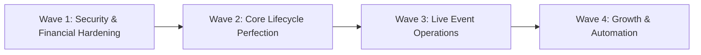

# CODESRIJAN — STRATEGIC 4-WAVE PRODUCT ROADMAP
**Product**: CodeSrijan Hackathon Management & Competition Matrix  
**Document Code**: `DISCOVERY-DOC-17` | **Architecture Horizon**: 2026 - 2027  
**Executive Perspective**: Chief Technology Officer & Principal Product Manager  

---

## 1. Roadmap Architecture & Execution Principles
CodeSrijan's product roadmap is structured into four sequential, value-accretive execution waves. Every wave maintains strict adherence to the **$0.00 additional monthly cloud budget**, prioritizing data integrity, security boundaries, and competitive fairness before introducing advanced convenience features.

---

## 2. Granular Wave-by-Wave Execution Plan

### Wave 1: Security, Financial Hardening & Multi-Tenant Foundations (P0 & P1)
- **Primary Goal**: Close critical security and financial vulnerabilities before scaling to multiple external organizers.
- **Key Deliverables**:
  1. **Multi-Tenant Schema & Middleware**: Introduce `Organization` entity; partition all events, registrations, and teams by `organizationId`. Implement `requireEventOwnership` guard.
  2. **Duplicate UTR Detection**: Unique compound index on `PaymentProof.transactionId` to eliminate double-spending of UPI reference numbers.
  3. **Atomic Payment Approval Lock**: Utilize Mongoose `findOneAndUpdate` with concurrency locking to eliminate race conditions between multiple administrators.
  4. **Multi-Team Enrollment Guard**: Enforce single-team participation per active event using compound unique indexes.
  5. **Financial Transaction Ledger**: Exportable CSV/Excel balance sheets for organizer accounting reconciliation.
- **Acceptance Criteria**: Zero cross-organizer data traversal; zero duplicate payment proof submissions permitted; 100% auditable payment approvals.

---

### Wave 2: Complete Core Hackathon Lifecycle (P1)
- **Primary Goal**: Perfect the end-to-end competitive workflow from discovery to certificate verification.
- **Key Deliverables**:
  1. **Multi-Event Discovery & Filtering**: Search bar on `/` and `/hackathons` with filters for category, online/offline, and free/paid.
  2. **Event Draft vs Published Status**: Allow organizers to configure and preview events before making them publicly discoverable.
  3. **GitHub Repository Pre-Flight Check**: Validate submitted GitHub URLs via public API and capture the exact Git commit SHA at submission deadline.
  4. **Submission Cryptographic Receipts**: Generate signed PDF/JSON receipts with server timestamps and SHA-256 payload checksums.
  5. **Multi-Criterion Weighted Scoring Rubrics**: Enable customizable scoring criteria (Innovation, Technical Depth, UI Polish, Presentation).
  6. **Blind Judging Anti-Bias Mode**: Mask participant names and colleges on evaluator dashboards.
  7. **Public Certificate Verification Portal**: Deploy `/verify/$id` route allowing external recruiters and LinkedIn viewers to independently verify authentic credentials.
- **Acceptance Criteria**: Builders receive cryptographic submission receipts; evaluators score via weighted rubrics; certificates verify publicly without login.

---

### Wave 3: Live Event Operations & Unified Comms (P2)
- **Primary Goal**: Transform CodeSrijan into a seamless day-of-event command center for 24-48 hour hackathons.
- **Key Deliverables**:
  1. **Dynamic Venue Check-in QR Scanner**: Mobile camera-based QR scanner on `/staff/checkin` to log physical attendance and table allocations.
  2. **Unified Organizer Command Cockpit**: Single-screen dashboard unifying live registrations, payment queues, submission velocity, and judging backlog.
  3. **Live Milestone & Schedule Engine**: Dynamic schedule manager on `/admin/schedule` featuring real-time "Happening Now" banners and stage links.
  4. **SOS Mentor Dispatch Concurrency Lock**: Atomic ticket claiming on `/mentor-command-center` to eliminate duplicate mentor responses.
  5. **Urgent Screen-Takeover Alerts**: Socket.io-driven modal broadcasts with audio chimes for critical deadline shifts or safety bulletins.
  6. **In-App Participant NPS Feedback Survey**: Automatic post-event sentiment surveys measuring venue, mentor, and platform satisfaction.
- **Acceptance Criteria**: Physical check-in completes in < 3 seconds per attendee; emergency broadcasts reach 100% of connected builders within 500ms.

---

### Wave 4: Growth, Developer Convenience & Automation (P3)
- **Primary Goal**: Long-term competitive differentiation, network effects, and enterprise scaling.
- **Key Deliverables**:
  1. **Google / GitHub 1-Click OAuth Sign-in**: Streamlined developer onboarding.
  2. **Automated Code Plagiarism Detection (MOSS)**: Background AST comparison engine flagging copied or pre-fabricated repositories.
  3. **Automated Payment Gateway Integration**: Razorpay/Cashfree webhook integration for automated ticket fee collection and instant refunds.
  4. **Personalized Teammate Matchmaking**: AI-assisted squad recommendations pairing free agents based on complementary specializations.
  5. **Project Hall of Fame & Permanent Showcase**: Public showcase of historical winning projects with interactive demo embeds.
  6. **Verified Collegiate Society Badges**: Trust verification badges for established chapters (ACM, IEEE, GDG).
- **Acceptance Criteria**: Seamless 1-click social logins; automated plagiarism flags generated prior to judging finalization.

