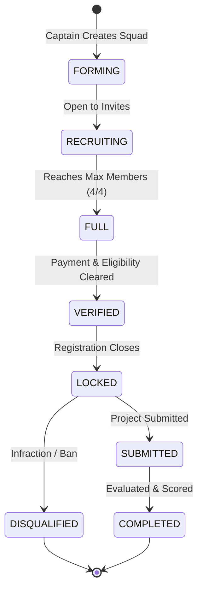

# CODESRIJAN — REGISTRATION & SQUAD MANAGEMENT GAP ANALYSIS
**Product**: CodeSrijan Hackathon Management & Competition Matrix  
**Document Code**: `DISCOVERY-DOC-07` | **Focus Area**: Participant Registration, Squad Formation & Teammate Discovery  
**Perspective**: Hackathon Operations Lead, Database Architect & Senior Security Auditor  

---

## 1. Executive Summary
Squad formation is the core dynamic of any hackathon. CodeSrijan provides a specialized **Squad Builder** (`/recruitment`) featuring a 3-tab layout (`FIND`, `JOIN`, `CREATE`) and specialization slotting badges. While visually compelling, the underlying business logic requires hardening against multi-team collisions, captain abandonment, and post-deadline roster manipulation.

---

## 2. Squad Lifecycle State Machine



---

## 3. Critical Edge Cases & Technical Analysis

### 3.1 Multi-Team Collision Prevention
- **The Risk**: Can a student participate in more than one team within the same hackathon?
- **Current Code Audit**:
  - `User.teamId` is a single string field on the user document.
  - When a user joins `Team B`, their `User.teamId` is updated, inadvertently detaching them from `Team A` without notifying Team A's captain.
- **Architectural Solution**:
  - Replace the global `User.teamId` with an event-scoped membership array:
    ```typescript
    interface UserEventAffiliation {
        hackathonId: string;
        teamId: string;
        roleInTeam: 'captain' | 'member';
        joinedAt: Date;
    }
    ```
  - Enforce a compound unique constraint: `Registration.ensureIndex({ userId: 1, hackathonId: 1 }, { unique: true })`.
  - A student can belong to Team Alpha in "CodeSrijan 2026" and Team Beta in "Winter Code Crucible", but can never join two squads in the same event.

---

### 3.2 Captain Abandonment & Leadership Succession
- **The Scenario**: What happens when the squad captain deletes their account or leaves the squad?
- **Current Behavior**: If the captain leaves, `Team.leaderId` points to an unlinked user ID, leaving the remaining teammates unable to accept new join requests or submit project payloads.
- **Required Business Rule**:
  1. A captain cannot leave a squad without explicitly delegating the captaincy to another member:
     `POST /api/teams/:id/transfer-leadership { newLeaderId: "user_xxx" }`.
  2. If the captain unregisters, leadership automatically cascades to the earliest joined teammate (`Team.memberIds[1]`).
  3. If a solo captain disbands the team, the squad is purged from the recruitment matrix.

---

### 3.3 Post-Deadline Roster Freezing
- **The Scenario**: Can teams add or swap members after the registration window closes?
- **Current Behavior**: Roster invitations remain technically dispatchable unless manually restricted.
- **Required Business Rule**:
  - Once `wallClockTime > hackathon.registrationEnd`, the team enters `LOCKED` state.
  - `handleInvite` and `handleRequestJoin` must be rejected with HTTP 403: `"Roster is locked. Registration window has concluded."`
  - Emergency member substitutions (e.g. medical illness) require formal organizer approval logged in the audit trail.

---

### 3.4 Disqualification Re-entry Prevention
- **The Scenario**: Can a banned or disqualified hacker rejoin the hackathon using another account or link up with an innocent squad?
- **Current Behavior**: Disqualifying a team sets `Team.status: 'disqualified'`, but does not flag the individual participant accounts.
- **Required Business Rule**:
  - When an admin executes `DISQUALIFY SQUAD` or `BAN TEAM`, the backend flags all members:
    `User.accountStatus: 'suspended'` or `Registration.status: 'disqualified'`.
  - Disqualified users cannot create new squads or accept invitations for that event.

---

### 3.5 Synchronization Across Submissions, Judging & Certificates
- **Integrity Requirement**: The roster existing at the moment of submission is the authoritative roster for judging and certificate issuance.
- **Implementation**:
  - When the final project is submitted, create a frozen snapshot:
    `Submission.frozenRoster: [ { userId, name, email, college, role } ]`.
  - Certificate generation queries `Submission.frozenRoster` rather than the live `Team` document, ensuring that members who joined after submission or post-event cannot claim undeserved certificates.

