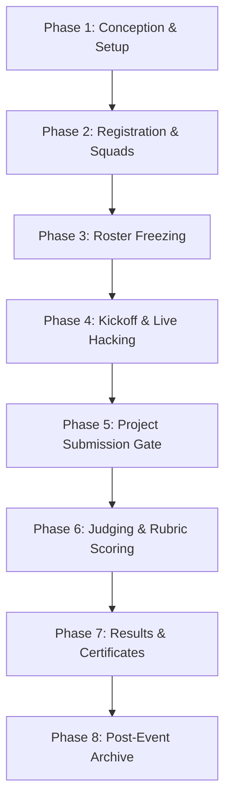
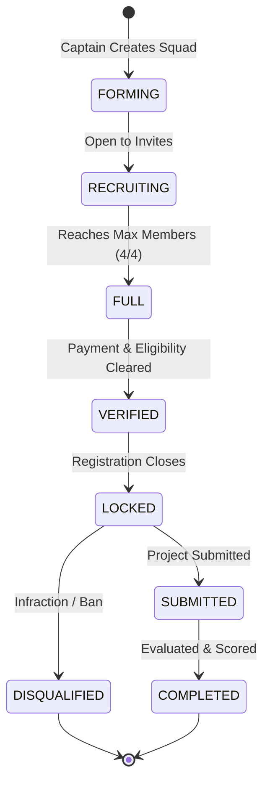
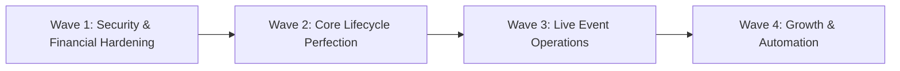

# CODESRIJAN — MASTER FULL PRODUCT DISCOVERY & COMPLETE PLATFORM AUDIT

**Consolidated Master Document containing all 18 Discovery Reports in Full Length**

---


================================================================================
=== DOCUMENT: CODE_SRIJAN_PRODUCT_OVERVIEW.md ===
================================================================================

# CODESRIJAN — STRATEGIC PRODUCT OVERVIEW & IDENTITY ANALYSIS
**Product**: CodeSrijan Hackathon Management & Competition Matrix  
**Executive Author**: Combined Office of the CTO, CPO, Lead Product Manager & Enterprise Architect  
**Audit Target**: Production Deployment (`https://codesrijan-nine.vercel.app` & API `https://codesrijan-api-6tfr.onrender.com/api`)  
**Document Code**: `DISCOVERY-DOC-01` | **Phase**: Pre-Implementation Discovery  

---

## 1. Executive Product Identity: What is CodeSrijan?

### 1.1 The Current Reality vs. The Strategic Vision
- **Current Technical Reality**: Today, CodeSrijan operates as a **single-tenant competitive hackathon hub** with a prominent neo-brutalist student builder experience. It features centralized event administration, pre-seeded challenge tracks, peer recruitment squads, manual UPI QR fee verification, a Discord-style support helpdesk, and cryptographic certificate issuance.
- **The Strategic Target**: To evolve from a single-club / single-college internal portal into an **enterprise-grade, multi-tenant Hackathon Management SaaS and Collegiate Builder Network**—capable of serving universities, corporate innovation labs, student clubs, and tech communities across India and globally.

---

## 2. Definitive Answers to the 30 Core Product Questions (Part 3)

### A. Product Identity and Business Model

#### 1. What exactly is CodeSrijan supposed to be?
CodeSrijan is an **end-to-end Hackathon Operating System & Student Builder Matrix**. It bridges the gap between marketing-first event directories (like Devfolio/Unstop) and developer collaboration tools (like Discord/GitHub), unifying discovery, squad formation, payment clearance, problem statement distribution, live mentoring, submission judging, and tamper-proof credential issuance in one high-performance interface.

#### 2. Is it a hackathon hosting website, a SaaS platform, a competition portal, or a community platform?
It is a **hybrid SaaS Competition Platform with integrated Community Dynamics**:
- **Hosting SaaS**: Organizers configure registration windows, upload banners, define rubrics, and manage admissions.
- **Competition Arena**: Teams lock problem statements, collaborate in workspaces, submit repositories, and get evaluated by judges.
- **Community Network**: Students build persistent builder profiles, recruit squad mates across specializations (Frontend, Backend, AI/ML, UI/UX, Cyber), and maintain friendships.

#### 3. Is the product designed for one central organizer or multiple independent organizers?
- **Current State**: Architected around **one central administrator** (`admin@codesrijan.com` / `role: admin`). All events exist in a shared global collection where any admin can edit or disqualify any squad.
- **Required Production Architecture**: Must support **Multiple Independent Organizers** (Clubs, Colleges, Companies). Organizer A (e.g. IIT Delhi ACM) must never see or alter Organizer B’s (e.g. GDG Noida) private registrations, scoring rubrics, or financial proofs.

#### 4. Can external colleges and companies create their own events?
- **Current State**: A `/host-event` public interest landing page exists, but it is currently an informational lead-capture form. Only root platform admins accessing `/admin/hackathons` can create live hackathons.
- **Recommendation**: Introduce an **Organizer Onboarding & Verification Gate**. Verified colleges and organizations can launch and run their own hackathons within isolated organizational boundaries.

#### 5. Should organizers apply and receive approval before hosting?
**Yes (Strict Recommendation)**. To prevent fraudulent prize claims, phishing scams, and fake UPI fee collection, an organizer application workflow is essential. Unverified organizers cannot publish public events or collect fees until authorized by CodeSrijan Super Administrators.

#### 6. Can any registered user create an event?
**No**. Allowing arbitrary students to publish public hackathons leads to spam, abandoned events, and reputation damage. Regular students have the role `student`. Only users granted `organizer` or `organization_admin` roles can spawn hackathon instances.

#### 7. Can one organization have multiple administrators?
**Yes**. Real university hackathons (e.g., HackNIT, CodeSrijan) have teams: Lead Organizer, Tech Lead, Sponsorship Head, Logistics Manager. An Organization entity must support role delegation (Admin, Staff, Moderator, Judge).

#### 8. Can an organization manage multiple hackathons?
**Yes**. A university technical society conducts an annual flagship 48-hour hackathon, seasonal beginner sprints, and internal code crucibles. The schema must link `Organization 1 : N Hackathons`.

#### 9. Can multiple organizations operate independently?
**Yes**. The multi-tenant architecture must partition events, teams, registrations, financial proofs, and support tickets by `organizationId`.

#### 10. Should participants have one global account for every hackathon?
**Yes**. A student should register once on CodeSrijan (`student@university.edu`), building a cumulative reputation: hackathons attended, awards won, peer endorsements, and verified certificates. They should not re-register a new account for every event.

#### 11. Should participants be able to participate in multiple simultaneous events?
**Yes, conditionally**. A student can register for multiple events, but they cannot join more than **one team per active hackathon**.

#### 12. Does every event get its own workspace?
**Yes**. Each hackathon requires an isolated **Event Cockpit**: specific countdowns, announcements, locked problem directives, team rosters, submission gates, and leaderboard.

#### 13. What should be managed globally by CodeSrijan?
- Core user authentication, identity, and global bans.
- Platform security, zero-cost cloud infrastructure, and uptime SLA.
- Certificate cryptographic verification registry.
- Global terms of service, privacy policy, and compliance.
- Payment gateway platform escrow and dispute arbitration.

#### 14. What should be managed by individual organizers?
- Event scheduling, banners, formats (Online, Offline, Hybrid).
- Registration criteria, eligibility, capacity, and admission fees.
- Problem statements, technological tracks, and scoring rubrics.
- Judge and mentor assignments.
- UPI QR upload or custom payment reconciliation.
- Local announcements, live support channels, and winner declarations.

#### 15. What is the long-term business model?
1. **Free Tier**: Free hackathons pay ₹0 platform fee.
2. **Paid Event Commission**: Small percentage (e.g., 3% - 5%) on participant ticket registrations when using automated payment processing.
3. **Organizer SaaS Subscription**: Pro features for universities/enterprises (custom domains, dedicated support bots, advanced anti-plagiarism scanning, branded certificates).
4. **Talent & Recruitment Pipeline**: Opt-in candidate hiring portal for tech sponsors searching for top 10% ranked hackathon finishers.

#### 16. Will CodeSrijan charge organizers?
- Standard student community hackathons: **Free ($0.00 platform fee)**.
- Enterprise / Corporate hiring hackathons: Tiered organizer licensing fee.

#### 17. Will CodeSrijan charge participants?
CodeSrijan will **never charge students a platform fee** to browse or participate in free hackathons. For paid events, the event organizer sets the ticket fee (e.g., ₹100), which is collected for venue/food/swag logistics.

#### 18. Will paid events be managed through manual UPI payments, an actual gateway, or both?
- **Phase 1 (Current)**: Manual UPI QR upload with student transaction ID submission and organizer verification.
- **Phase 2 (Production Scale)**: Dual option. Organizers can use instant automated Razorpay/Cashfree gateway integration (zero manual review) OR manual UPI verification for student societies without business bank accounts.

#### 19. Will sponsorships and prize distributions be managed on the platform?
- **Sponsorships**: Platform showcases corporate sponsor tiers (Title, Platinum, Gold) with direct analytics on clicks and booth visits.
- **Prize Distributions**: Platform records prize disbursements, tax acknowledgments, and winner ledger receipts to prevent organizer fraud.

#### 20. Which features are essential for launch vs future improvements?
- **Launch Essentials (P0/P1)**: Multi-role authentication, resilient hackathon creation wizard, team formation, problem embargo/release, submission file/repo locking, weighted judge scoring, live leaderboard, certificate vault, support desk.
- **Future Horizon (P2/P3)**: Live video judging breakout rooms, automated code plagiarism analysis (MOSS), Razorpay escrow payouts, native Discord OAuth bot synchronization.

---

### B. Product Positioning & Competitive Advantage

#### 21. Who is the primary audience?
1. **Student Builders & Hackers** seeking serious technical competitions, peer squad discovery, and verifiable credentials.
2. **Collegiate Tech Societies & Clubs** looking for a zero-cost, modern alternative to messy Google Forms + Excel sheets.
3. **Corporate Tech Recruiters & Sponsors** looking to discover authentic engineering talent through practical problem execution.

#### 22. Why students?
Students are tired of generic competition directories with broken team formation tools and delayed results. CodeSrijan offers a cyberpunk/neo-brutalist "Hacker Matrix" where finding teammates by tech stack (Frontend, AI/ML, Backend) is instantaneous.

#### 23. Why colleges and universities?
Colleges currently run hackathons using disjointed tools: Google Forms for registration, WhatsApp for communication, Google Drive for submission links, and Canva for certificate generation. CodeSrijan consolidates this into one cohesive system.

#### 24. Why companies?
Companies can sponsor tracks, provide custom APIs, review submissions in real time, and evaluate candidate code directly without waiting weeks for post-event resumes.

#### 25. Why startup communities?
Startup ecosystems (incubators, accelerators) need rapid innovation sprints with clear intellectual property assignment and structured evaluation criteria.

#### 26. Why independent event organizers?
Independent tech communities (e.g. local Python or Rust groups) need a lightweight, zero-budget platform that runs without expensive subscription costs.

#### 27. Why gaming and technical communities?
Game jams and specialized CTFs (Capture The Flag) require rapid asset uploads, clear track separation, and immediate community leaderboards.

#### 28. Should the experience be optimized primarily for students, organizers, or both?
**Bilateral Optimization**:
- The **Student Experience** must be frictionless: 30-second registration, instant squad linking via token, clear problem countdowns, and instant certificate downloads.
- The **Organizer Experience** must be bulletproof: comprehensive governance HUD, bulk verification, submission exports, rubric scoring, and zero data loss.

#### 29. What makes CodeSrijan different from Google Forms + Spreadsheets?
| Feature | Google Forms + Sheets | CodeSrijan Platform |
| :--- | :--- | :--- |
| Squad Formation | Manual emailing; students struggle to find peers | In-app Squad Builder with specialization slotting & invite codes |
| Problem Release | Manual email blasts; prone to leaks | Timed cryptographic embargo; instant synchronized live unlock |
| Payment Clearance | Manual bank checking against blurry screenshots | Structured UPI reference tracking, duplicate detection, and review queue |
| Project Submissions | Drive links with permissions errors; broken links | Versioned submission receipts, repo validation, and preview embeds |
| Judging & Scoring | Messy Excel sheets with broken formulas | Multi-judge weighted rubrics, automatic score normalization & leaderboard |
| Credentials | Manual mail-merge certificates; easy to Photoshop | Immutable SHA-256 verified digital certificates with public verification |

#### 30. What makes CodeSrijan worth using for an organizer?
It saves **40+ hours of administrative overhead** per event, eliminates judging disputes through auditable rubrics, provides 24/7 AI-assisted participant support via SrijanBot, and delivers a memorable, high-energy brand experience for builders.


================================================================================
=== DOCUMENT: CURRENT_PAGE_AND_ROUTE_INVENTORY.md ===
================================================================================

# CODESRIJAN — COMPLETE PAGE & ROUTE INVENTORY
**Product**: CodeSrijan Hackathon Management & Competition Matrix  
**Router**: TanStack Router (`src/routes/`) | **Total Discovered Routes**: 49  
**Document Code**: `DISCOVERY-DOC-02` | **Audit Date**: 2026-10-30  

---

## 1. Route Architecture Overview
The frontend architecture utilizes file-based routing orchestrated via `@tanstack/react-router`. Routes are partitioned into four operational tiers:
1. **Public Marketing & Informational Surfaces** (Accessible to all visitors)
2. **Identity & Authentication Handshake Surfaces** (Session establishment)
3. **Student / Builder Cockpit Surfaces** (Authenticated participants & teams)
4. **Administrative Governance Surfaces** (Restricted to platform directors)

---

## 2. Exhaustive Route Inventory Matrix

### Tier 1: Public Discovery & Informational Surfaces (12 Routes)

| # | Route URL | Source File | Authorized Roles | Primary Functionality & Interactive Elements | Dependent Backend APIs | Production Status |
| :--- | :--- | :--- | :---: | :--- | :--- | :---: |
| 1 | `/` | `index.tsx` | All / Anonymous | Neo-brutalist landing page, Hero banner, Hackathon teaser, Track badges, SrijanBot trigger | `GET /api/hackathons` | **ACTIVE** |
| 2 | `/about` | `about.tsx` | All / Anonymous | Platform philosophy, zero-budget architecture, mission overview, brand emblem | Static content | **ACTIVE** |
| 3 | `/announcements` | `announcements.tsx` | All / Anonymous | Category-filtered bulletins (`ALL`, `GLOBAL`, `ARENA`, `PRIORITY`) | `GET /api/announcements` | **ACTIVE** |
| 4 | `/sponsors` | `sponsors.tsx` | All / Anonymous | Corporate partner showcases with SVG brand assets & partner links | `GET /api/sponsors` | **ACTIVE** |
| 5 | `/timeline` | `timeline.tsx` | All / Anonymous | Visual hackathon milestone pipeline, calendar & agenda view toggles | `GET /api/calendar-events` | **ACTIVE** |
| 6 | `/faq` | `faq.tsx` | All / Anonymous | Expandable accordion of frequent participant queries & rules | `GET /api/faqs` | **ACTIVE** |
| 7 | `/gallery` | `gallery.tsx` | All / Anonymous | Showcase of past hackathon project submissions and media | `GET /api/gallery` | **ACTIVE** |
| 8 | `/code-of-conduct`| `code-of-conduct.tsx`| All / Anonymous | Hackathon ethics, anti-harassment rules, and integrity policies | Static content | **ACTIVE** |
| 9 | `/privacy-policy` | `privacy-policy.tsx`| All / Anonymous | Data collection, usage, and privacy disclosure documentation | Static content | **ACTIVE** |
| 10| `/host-event` | `host-event.tsx` | All / Anonymous | Organizer lead capture and host-application submission form | `POST /api/host-requests` | **ACTIVE** |
| 11| `/community` | `community.tsx` | All / Anonymous | Student builder matrix showcase and community links | `GET /api/users` | **ACTIVE** |
| 12| `/highlights` | `highlights.tsx` | All / Anonymous | Curated project highlights, winner spotlights, and press reel | Static / Gallery | **ACTIVE** |

---

### Tier 2: Authentication & Identity Lifecycle Surfaces (7 Routes)

| # | Route URL | Source File | Access Control | Primary Action & Security Constraints | Dependent Backend APIs | Production Status |
| :--- | :--- | :--- | :---: | :--- | :--- | :---: |
| 13| `/login` | `login.tsx` | Public / Guest | Email/password login form, Firebase client SDK fallback to JWT | `POST /api/auth/login` | **ACTIVE** |
| 14| `/register` | `register.tsx` | Public / Guest | Multi-field registration (Name, Email, College, Specialization) | `POST /api/auth/register`| **ACTIVE** |
| 15| `/auth/otp` | `auth.otp.tsx` | Pending Verification| 6-digit numeric OTP cell verification matrix with resend cooldown | `POST /api/auth/verify-email` | **ACTIVE** |
| 16| `/auth/forgot-password` | `auth.forgot-password.tsx` | Public / Guest | Password reset email dispatcher | `POST /api/auth/forgot-password` | **ACTIVE** |
| 17| `/auth/reset-password` | `auth.reset-password.tsx` | Public / Token | Secure password reset form validated via URL token | `POST /api/auth/reset-password` | **ACTIVE** |
| 18| `/invite/$token` | `invite.$token.tsx` | Authenticated | Automatic squad joining via cryptographically signed invitation link | `POST /api/teams/join-invite` | **ACTIVE** |
| 19| `/admin-login` | `admin-login.tsx` | Public / Admin | Dedicated administrator portal login surface | `POST /api/auth/login` | **ACTIVE** |

---

### Tier 3: Student Builder Cockpit & Workspace Surfaces (14 Routes)

| # | Route URL | Source File | Required Role | Primary Operational Capabilities | Dependent Backend APIs | Production Status |
| :--- | :--- | :--- | :---: | :--- | :--- | :---: |
| 20| `/dashboard` | `dashboard.tsx` | Student (or Admin) | Operative workspace HUD, countdown timer, fee status, squad alliance | `GET /api/hackathons`, `GET /api/auth/me` | **ACTIVE** |
| 21| `/problems` | `problems.tsx` | Student / All | Technological track filter bar, classified problem lock, dossier modal | `GET /api/problems` | **ACTIVE** |
| 22| `/challenge` | `challenge.tsx` | Student | Focused single problem statement operational specifications | `GET /api/problems/:id` | **ACTIVE** |
| 23| `/recruitment` | `recruitment.tsx` | Student | Squad Builder (Find/Join/Create tabs), Specialization slotting bar | `GET /api/teams`, `GET /api/users` | **ACTIVE** |
| 24| `/certificates` | `certificates.tsx` | Student | Official Certificate Matrix, verified SHA-256 signatures, PDF downloads | `GET /api/certificates` | **ACTIVE** |
| 25| `/support` | `support.tsx` | Student | Discord Ticket Bot interface, real-time ticket threads, TALK TO ADMIN | `GET /api/support/tickets` | **ACTIVE** |
| 26| `/leaderboard` | `leaderboard.tsx` | Student / All | Arena standings matrix, verified rubric score breakdowns, search & filter | `GET /api/evaluations` | **ACTIVE** |
| 27| `/profile` | `profile.tsx` | Student | Builder dossier, skills badges, social links, college & year edit | `GET /api/users/profile` | **ACTIVE** |
| 28| `/profile-overview`| `profile-overview.tsx`| Student | Publicly viewable builder card with awards and team history | `GET /api/users/:id/profile` | **ACTIVE** |
| 29| `/team` | `team.tsx` | Student (In Team) | Team roster management, invite codes, member kick/leave controls | `GET /api/teams/:id` | **ACTIVE** |
| 30| `/workspace` | `workspace.tsx` | Student (In Team) | Collaborative project workspace, task kanban, repo submission uploader | `GET /api/teams/:id/tasks`, `POST /api/submissions` | **ACTIVE** |
| 31| `/payment` | `payment.tsx` | Student | Official event fee payment details, UPI QR code, payment proof upload | `POST /api/payments/proof` | **ACTIVE** |
| 32| `/chat` | `chat.tsx` | Student / Team | Real-time squad and administrative direct communication channel | Socket.io / `/api/conversations` | **ACTIVE** |
| 33| `/notifications`| `notifications.tsx`| Student | Notification history, category filtering, unread indicator | `GET /api/notifications` | **ACTIVE** |

---

### Tier 4: Role-Specific Specialized Surfaces (3 Routes)

| # | Route URL | Source File | Required Role | Functionality & Access Bounds | Dependent Backend APIs | Production Status |
| :--- | :--- | :--- | :---: | :--- | :--- | :---: |
| 34| `/mentor` | `mentor.tsx` | Mentor / Admin | Mentor dashboard, active squad dispatch requests, table assistance queue | `GET /api/mentor/requests` | **ACTIVE** |
| 35| `/mentor-command-center` | `mentor-command-center.tsx` | Mentor / Admin | Live SOS mentor routing, emergency assistance dispatch terminal | `GET /api/mentor/sos` | **ACTIVE** |
| 36| `/evaluations` | `evaluations.tsx` | Judge / Admin | Judge evaluation matrix, assigned submission scoring rubrics, feedback notes | `GET /api/evaluations/assigned` | **ACTIVE** |

---

### Tier 5: Administrative Governance Surfaces (13 Routes)

| # | Route URL | Source File | Required Role | Administrative Authority & Governance Scope | Dependent Backend APIs | Production Status |
| :--- | :--- | :--- | :---: | :--- | :--- | :---: |
| 37| `/admin` | `admin.tsx` | Admin Strict | Governance layout wrapper, sidebar navigation, directorate header | Layout wrapper | **ACTIVE** |
| 38| `/admin/index` | `admin.index.tsx` | Admin Strict | Platform high-level analytics, active users, hackathons, open tickets | `GET /api/admin/stats` | **ACTIVE** |
| 39| `/admin/hackathons`| `admin.hackathons.tsx`| Admin Strict | Event lifecycle management, 5-Step Hackathon Wizard (Banner & QR upload) | `GET/POST /api/hackathons` | **ACTIVE** |
| 40| `/admin/users` | `admin.users.tsx` | Admin Strict | Global user registry, role mutation, ban/suspend accounts | `GET /api/users` | **ACTIVE** |
| 41| `/admin/teams` | `admin.teams.tsx` | Admin Strict | Global squad directorate, roster review, manual team modification | `GET /api/teams` | **ACTIVE** |
| 42| `/admin/problems` | `admin.problems.tsx` | Admin Strict | Challenge directive creation, track assignment, embargo scheduling | `GET/POST /api/problems` | **ACTIVE** |
| 43| `/admin/submissions`| `admin.submissions.tsx`| Admin Strict | Central project submission repository, code repository & demo link review | `GET /api/submissions` | **ACTIVE** |
| 44| `/admin/evaluations`| `admin.evaluations.tsx`| Admin Strict | Judging rubrics manager, score aggregation, tie-breaker override | `GET /api/evaluations` | **ACTIVE** |
| 45| `/admin/payments` | `admin.payments.tsx` | Admin Strict | UPI payment proof verification console, approve/reject transactions | `GET/PATCH /api/payments` | **ACTIVE** |
| 46| `/admin/support` | `admin.support.tsx` | Admin Strict | Central helpdesk dispatcher, ticket assignments, Discord thread management | `GET/PATCH /api/support` | **ACTIVE** |
| 47| `/admin/announcements`| `admin.announcements.tsx`| Admin Strict | System broadcast composer, targeted priority alert dispatch | `POST /api/announcements` | **ACTIVE** |
| 48| `/admin/certificates`| `admin.certificates.tsx`| Admin Strict | Official certificate file uploader, batch issuance, SHA-256 hash generation | `POST /api/certificates` | **ACTIVE** |
| 49| `/admin/logs` | `admin.logs.tsx` | Admin Strict | Security audit trails, IP tracking, administrative action log | `GET /api/admin/logs` | **ACTIVE** |


================================================================================
=== DOCUMENT: PAGE_BY_PAGE_MISSING_FEATURE_ANALYSIS.md ===
================================================================================

# CODESRIJAN — PAGE-BY-PAGE DETAILED AUDIT & MISSING-FEATURE ANALYSIS
**Product**: CodeSrijan Hackathon Management & Competition Matrix  
**Document Code**: `DISCOVERY-DOC-03` | **Audit Scope**: Complete 49 TanStack Routes  
**Perspective**: CTO, CPO, Senior UI/UX Architect, and Lead Product Manager  

---

## 1. Public Marketing & Event Discovery Surfaces

### 1.1 Homepage (`/` -> `src/routes/index.tsx`)
- **Allowed Roles**: All / Guest / Anonymous
- **Intended Purpose**: Primary marketing gateway, event discovery, platform value proposition, participant call-to-action.
- **Current Functionality**: Neo-brutalist hero section, headline "The student-driven competitive hackathon matrix", active hackathon teaser card (`CODESRIJAN 24-HOUR HACKATHON`), technological track badges, stats ticker, and floating SrijanBot.
- **Interactive Controls**: `REGISTER NOW` CTA, `Explore Parameters` buttons on tracks, `Admin Panel` button in navbar.
- **Backend Dependencies**: `GET /api/hackathons`.
- **What's Missing**:
  - No search bar to search hackathons by name, technology, or host college.
  - No filter for Online vs Offline vs Hybrid events.
  - No filter for Free vs Paid admission.
  - No distinction between Featured, Ongoing, Upcoming, and Completed/Archived hackathons.
  - The "99.98% UPTIME" and stats are hardcoded rather than dynamically queried from live database aggregates.
  - No organizer onboarding CTA (e.g. "Host a Hackathon on CodeSrijan").
- **What's Confusing**:
  - The navbar contains an "Admin Panel" button visible to anonymous visitors, tempting unauthorized clicks which lead to login redirects.
- **Risks & Vulnerabilities**:
  - Single active hackathon design makes the platform look like a one-off event website rather than a reusable hackathon ecosystem.
- **Priority**: **P1 (Essential)**
- **Recommended UX Overhaul**:
  - Transform homepage into a **Multi-Event Discovery Hub**: Search bar with autocompletion, category filter pills (`AI/ML`, `Web3`, `Systems`, `Open Innovation`), event status tabs (`Active Now`, `Upcoming`, `Past Winners`), and a prominent dual-CTA: `Join as Hacker` vs `Host a Hackathon`.

---

### 1.2 About Page (`/about` -> `src/routes/about.tsx`)
- **Allowed Roles**: All / Guest
- **Purpose**: Explain the platform architecture, mission, collegiate credibility, and zero-budget philosophy.
- **Current Functionality**: Displays CodeSrijan brand emblem, architecture explanation, and technical overview.
- **What's Missing**:
  - No team credits, collegiate advisory board, or contact directory.
  - No downloadable media kit or brand guidelines.
  - No link to organizer case studies or success metrics.
- **Priority**: **P3 (Future)**

---

### 1.3 Announcements Page (`/announcements` -> `src/routes/announcements.tsx`)
- **Allowed Roles**: All / Guest
- **Purpose**: Central bulletin board for platform alerts, urgent schedule changes, and event updates.
- **Current Functionality**: Displays announcements list with category filters (`ALL`, `GLOBAL`, `ARENA`, `PRIORITY`).
- **Interactive Controls**: Filter tabs.
- **Backend Dependencies**: `GET /api/announcements`.
- **What's Missing**:
  - Announcements are not scoped to specific hackathons; all bulletins appear in a single global feed.
  - No push-notification subscription toggle or RSS/Atom feed.
  - No search box within bulletins.
  - No "Acknowledge" button for mandatory safety or conduct bulletins.
- **Priority**: **P2 (Important)**

---

### 1.4 Sponsors Page (`/sponsors` -> `src/routes/sponsors.tsx`)
- **Allowed Roles**: All / Guest
- **Purpose**: Corporate partner showcase, sponsorship tier transparency, recruiter links.
- **Current Functionality**: Renders 5 corporate partner cards with SVG logos and external hyperlinks.
- **What's Missing**:
  - No "Become a Sponsor" prospectus download button or inquiry form.
  - No tier distinctions (Title, Platinum, Gold, Community, Cloud Partner).
  - No sponsor perks (API credits, job openings, recruiter links).
- **Priority**: **P2 (Important)**

---

### 1.5 Timeline Page (`/timeline` -> `src/routes/timeline.tsx`)
- **Allowed Roles**: All / Guest
- **Purpose**: Visual event milestones, stage countdowns, and schedule.
- **Current Functionality**: Displays timeline cards with Agenda vs Calendar grid view toggles.
- **What's Missing**:
  - The schedule displays a single event timeline. If multiple hackathons exist, their timelines collide.
  - No "Add to Google Calendar / iCal" export button.
  - No automatic timezone converter for international or remote participants.
- **Priority**: **P1 (Essential)**

---

### 1.6 Host an Event Page (`/host-event` -> `src/routes/host-event.tsx`)
- **Allowed Roles**: All / Guest
- **Purpose**: Organizer application and inquiry intake.
- **Current Functionality**: Form collecting organizer name, college, email, expected participant size, and dates.
- **Backend Dependencies**: `POST /api/host-requests`.
- **What's Missing**:
  - No status tracker for submitted applications (e.g. "Pending Review", "Approved").
  - No instant organizer workspace provisioning upon admin approval.
  - No pricing calculator or plan selection.
- **Priority**: **P1 (Essential)**

---

## 2. Authentication & Identity Surfaces

### 2.1 Login & Registration (`/login`, `/register`)
- **Current Functionality**: Form handling email, password, college, specialization. Firebase Auth with Express fallback.
- **What's Missing**:
  - No Google / GitHub OAuth one-click sign-in (critical for developers).
  - No "Remember Me" toggle.
  - Password strength meter is missing on registration.
- **What's Confusing**:
  - Error messages previously returned raw server errors; now resolved to neo-brutalist alert banners.
- **Priority**: **P1 (Essential)**

### 2.2 OTP Verification (`/auth/otp`)
- **Current Functionality**: 6 individual numeric inputs with automatic focus forwarding.
- **What's Missing**:
  - No fallback option if email delivery fails (e.g. WhatsApp/SMS OTP).
  - Resend cooldown timer resets on page refresh.
- **Priority**: **P2 (Important)**

---

## 3. Student Builder Cockpit Surfaces

### 3.1 Student Dashboard (`/dashboard` -> `src/routes/dashboard.tsx`)
- **Current Functionality**: Student HUD, active event card, countdown timer, payment status (`FEE DUE: ₹100` with yellow action button), active squad alliance card, quick comm links.
- **What's Missing**:
  - Only displays the *first* registered hackathon; does not support viewing multiple registered events.
  - No project submission quick-link directly on the dashboard when submission window opens.
  - No live notifications drawer or recent announcement cards.
- **Priority**: **P1 (Essential)**

### 3.2 Problem Statements Matrix (`/problems` -> `src/routes/problems.tsx`)
- **Current Functionality**: Track filter pills, classified problem lock state (`[CLASSIFIED SECURITY PROTOCOL // PENDING DIRECTORATE AUTHORIZATION]`), Directive Dossier modal.
- **What's Missing**:
  - No "Bookmark Problem" capability.
  - No indicator showing how many squads have chosen each problem (track popularity).
  - No submission upload button directly inside the problem dossier.
- **Priority**: **P1 (Essential)**

### 3.3 Squad Recruitment Marketplace (`/recruitment` -> `src/routes/recruitment.tsx`)
- **Current Functionality**: Three-tab layout (`FIND`, `JOIN`, `CREATE`), candidate search, Specialization Slotting bar, View Profile modal.
- **What's Missing**:
  - No squad invitation inbox where students can accept or decline pending squad invites.
  - Team creation allows picking arbitrary names without checking for duplicate names within the same hackathon.
  - No squad chat deep-link from the team card.
- **Priority**: **P1 (Essential)**

### 3.4 Official Certificates Matrix (`/certificates` -> `src/routes/certificates.tsx`)
- **Current Functionality**: Displays official verified certificates issued to the authenticated student, SHA-256 hash, and download button.
- **What's Missing**:
  - No public verification URL (e.g. `/verify-certificate?id=...`) that students can share on LinkedIn.
  - No "Add to LinkedIn Profile" 1-click button.
- **Priority**: **P1 (Essential)**

### 3.5 Project Workspace (`/workspace` -> `src/routes/workspace.tsx`)
- **Current Functionality**: Team task kanban board, submission repository link input, demo URL input, file uploaders.
- **What's Missing**:
  - No version history or submission receipt download.
  - Does not validate whether repository links are public (e.g. 404 on private GitHub repos).
  - No preview iframe for submitted live demo URLs.
- **Priority**: **P1 (Essential)**

---

## 4. Administrative Governance Surfaces

### 4.1 Admin Hackathons Directorate (`/admin/hackathons`)
- **Current Functionality**: Hackathon list, "+ CREATE HACKATHON" 5-Step Wizard with dedicated 1200x630 banner uploader and 500x500 UPI QR uploader.
- **What's Missing**:
  - No "Duplicate Event" button (forcing organizers to re-type tracks and rules for annual editions).
  - No "Draft vs Published" status toggle; creating a hackathon immediately makes it visible.
  - No multi-tenant filtering by organizing college/organization.
- **Priority**: **P1 (Essential)**

### 4.2 Admin Payments Reconciliation (`/admin/payments`)
- **Current Functionality**: Table of submitted payments, UPI reference ID, proof screenshot viewer, Approve and Reject buttons.
- **What's Missing**:
  - No CSV/Excel export of financial transactions for accounting reconciliation.
  - No duplicate transaction detection (a student could submit the same UPI UTR twice).
  - No recorded audit trail of *which* admin approved a payment.
  - No dispute resolution queue or partial refund tracking.
- **Priority**: **P0 (Critical Security & Finance)**

### 4.3 Admin Evaluations & Judging (`/admin/evaluations`)
- **Current Functionality**: Matrix of submitted projects, score cards, evaluation status.
- **What's Missing**:
  - No blind judging toggle (evaluators can see team and college names, introducing bias).
  - No normalization algorithm for harsh vs generous judges.
  - No tie-breaking protocol when two squads receive identical aggregate scores.
- **Priority**: **P1 (Essential)**

### 4.4 Admin Support & Helpdesk (`/admin/support`)
- **Current Functionality**: Global Discord-style ticket dispatch queue, thread conversation viewer, Close Ticket button.
- **What's Missing**:
  - No ticket assignment to specific staff/mentors.
  - No ticket priority tagging (`URGENT`, `SOS`, `GENERAL`).
  - No canned responses for common questions.
- **Priority**: **P2 (Important)**


================================================================================
=== DOCUMENT: USER_ROLES_AND_PERMISSION_MATRIX.md ===
================================================================================

# CODESRIJAN — USER ROLES & ROLE-BASED ACCESS CONTROL (RBAC) MATRIX
**Product**: CodeSrijan Hackathon Management & Competition Matrix  
**Document Code**: `DISCOVERY-DOC-04` | **Target Schema**: Multi-Tenant RBAC Matrix  
**Executive Author**: Senior Security Architect & Identity Governance Specialist  

---

## 1. Executive Summary & Identity Architecture
The current production codebase implements a coarse 4-role model (`student`, `admin`, `judge`, `mentor`) managed via `store.tsx` and Express JWT middleware. To support multi-college hackathons, corporate sponsors, independent organizers, and fair evaluations, CodeSrijan requires an 11-role granular hierarchy with strict multi-tenant boundary isolation.

---

## 2. Comprehensive 11-Role Operational Profiles

### 1. Guest (Unauthenticated Visitor)
- **Can See**: Public landing page, published hackathon overviews, public problem statements (when unembargoed), announcements, sponsor grid, timeline, rules, FAQ, and public winner galleries.
- **Can Create**: Self-registration account (`POST /api/auth/register`), organizer application (`POST /api/host-requests`).
- **Can Edit / Delete / Approve / Publish**: Strictly **NONE**.
- **Private Data**: Cannot view any participant emails, team rosters, draft submissions, or financial proofs.
- **Required Authorizations**: Captcha protection on registration to prevent bot account creation.

### 2. Student / Participant
- **Can See**: Student Dashboard HUD, active hackathon telemetry, challenge statements, recruitment marketplace, personal certificate vault, Discord support desk, public leaderboard.
- **Can Create**: Join requests to teams, support tickets, payment proof uploads, candidate recruitment profile.
- **Can Edit**: Personal profile (bio, GitHub, skills, college, graduation year).
- **Can Delete**: Personal join requests before acceptance.
- **Can Approve / Publish**: None.
- **Private Data**: Personal phone number, payment transaction ID, and private support messages are restricted to self and event administrators.

### 3. Team Leader (Squad Captain)
- **Inherits**: All Student / Participant capabilities.
- **Can See**: Squad invite tokens, pending join requests from free agents, project task board, repository submission fields.
- **Can Create**: Squad instance (`POST /api/teams`), invite links, project submission.
- **Can Edit**: Squad name, logo, repository URL, demo URL, presentation deck, problem statement selection.
- **Can Delete / Kick**: Disband squad (before registration deadline), kick non-performing members.
- **Can Approve**: Accept incoming join requests from candidate builders.
- **Can Publish**: Submit official project payload for judging.
- **Private Access**: Squad secret token, member emergency contacts.

### 4. Team Member
- **Inherits**: All Student / Participant capabilities.
- **Can See**: Squad workspace, assigned tasks, team chat room, submission status.
- **Can Create**: Project tasks, task comments, chat messages.
- **Can Edit**: Personal assigned tasks and task completion status.
- **Restrictions**: Cannot disband squad, kick teammates, change squad problem statement, or mutate final submission links without captain authorization.

### 5. Event Organizer
- **Scope**: Strictly isolated to assigned `hackathonId` and `organizationId`.
- **Can See**: Event dashboard, registered participants, squad roster, payment proof submissions, problem statement drafts, assigned judges, support tickets.
- **Can Create**: Event schedules, technological tracks, problem statements, rubrics, custom FAQs, event announcements.
- **Can Edit**: Event dates, banners, problem descriptions, participant status.
- **Can Approve**: Manual UPI payment receipts, team registrations, late submission exceptions.
- **Can Publish**: Problem statement release (manual or timed), event announcements, official results.
- **Strict Tenant Boundary**: **Cannot** view, edit, or approve events, payments, or participants belonging to other organizers.

### 6. Organization Administrator (Collegiate Society Head / Dean)
- **Scope**: Manages the overarching `Organization` entity (e.g. "ACM Student Chapter, IIT Delhi").
- **Can See**: All hackathons hosted by the organization, organization revenue, audit logs.
- **Can Create**: New hackathon instances under organization quota, invite staff organizers.
- **Can Edit**: Organization profile, verified college badges, bank/UPI payout information.
- **Can Approve / Revoke**: Organizer staff roles within their organization.

### 7. Judge (Evaluator)
- **Can See**: Assigned submissions, evaluation rubrics, criteria weighting schemas, blind project repos and demos.
- **Can Create**: Draft evaluation scores, feedback notes, criterion-by-criterion ratings.
- **Can Edit**: Draft scores until the evaluation window locks.
- **Can Approve / Publish**: Submit finalized evaluation scores (`POST /api/evaluations/:id/finalize`).
- **Private Isolation**: Cannot view other judges' real-time scores before publication; cannot view participant names or colleges if Blind Judging is enabled.

### 8. Mentor
- **Can See**: Assigned hackathon tracks, active student help tickets, live SOS mentor requests, table numbers/channels.
- **Can Create**: Mentor advice logs, session summaries, resource links.
- **Can Edit**: Status of assigned mentor requests (`Claimed`, `In Progress`, `Resolved`).
- **Restrictions**: Cannot score submissions, approve payments, or view confidential problem statements before embargo lift.

### 9. Moderator
- **Can See**: Chat messages, community discussions, reported users, offensive squad names.
- **Can Create**: Warning notices, moderation flags.
- **Can Edit**: Sanitize inappropriate team names or profile bios.
- **Can Delete**: Remove spam or abusive chat messages.
- **Can Approve**: Escalate severe infractions to platform administrators.

### 10. Volunteer / Event Staff
- **Scope**: Physical venue operations and logistics.
- **Can See**: Participant attendance list, check-in QR scanner, food/swag badge status, table allocations.
- **Can Create**: Check-in scan timestamps.
- **Restrictions**: Read-only access to participant profiles; zero access to financial accounts, problem creation, or judging scores.

### 11. CodeSrijan Super Admin (Platform Owner)
- **Scope**: Global system governance.
- **Can See**: Global platform telemetry, all organizations, all users, financial ledgers, audit logs, system health.
- **Can Create**: Platform-wide broadcasts, new organization authorizations.
- **Can Edit**: System configurations, maintenance modes, fee structures.
- **Can Delete / Suspend**: Suspend fraudulent organizations, ban abusive accounts platform-wide.
- **Audit Requirement**: Every super-admin override must be immutably recorded in `ActivityLog`.

---

## 3. Comprehensive Role-Permission Matrix

| Action / Capability | Guest | Student | Captain | Member | Organizer | Org Admin | Judge | Mentor | Mod | Staff | Super Admin |
| :--- | :---: | :---: | :---: | :---: | :---: | :---: | :---: | :---: | :---: | :---: | :---: |
| **Browse Public Events** | Yes | Yes | Yes | Yes | Yes | Yes | Yes | Yes | Yes | Yes | Yes |
| **Register for Event** | No | Yes | Yes | Yes | No | No | No | No | No | No | No |
| **Create Team** | No | Yes | Yes | No | No | No | No | No | No | No | No |
| **Invite Teammates** | No | No | Yes | No | No | No | No | No | No | No | No |
| **Submit Project Repo** | No | No | Yes | No | No | No | No | No | No | No | No |
| **Upload Payment Proof**| No | Yes | Yes | No | No | No | No | No | No | No | No |
| **Verify / Approve Payment**| No | No | No | No | Yes | Yes | No | No | No | No | Yes |
| **Create Hackathon** | No | No | No | No | Yes | Yes | No | No | No | No | Yes |
| **Release Problems** | No | No | No | No | Yes | Yes | No | No | No | No | Yes |
| **Score Submissions** | No | No | No | No | No | No | Yes | No | No | No | Override |
| **Claim SOS Mentor Request**| No | No | No | No | No | No | No | Yes | No | No | Yes |
| **Scan Venue Check-In QR**| No | No | No | No | Yes | Yes | No | No | No | Yes | Yes |
| **Issue Certificates** | No | No | No | No | Yes | Yes | No | No | No | No | Yes |
| **Ban / DIQ Squad** | No | No | No | No | Yes | Yes | No | No | No | No | Yes |
| **Platform Config / Env**| No | No | No | No | No | No | No | No | No | No | Yes |

---

## 4. Multi-Tenant Event Isolation Protocol
To enforce strict boundary isolation between Organizer A and Organizer B:
1. **Schema Partitioning**: All events, registrations, teams, and submissions must contain an immutable `organizationId`.
2. **Middleware Verification (`requireEventOwnership`)**:
   ```javascript
   const event = await Hackathon.findById(req.params.hackathonId);
   if (req.user.role !== 'super_admin' && event.organizationId !== req.user.organizationId) {
       return res.status(403).json({ error: "Access Denied: You do not own this hackathon." });
   }
   ```
3. **URL Traversal Prevention**: Direct tampering with `hackathonId` in REST paths or TanStack router queries results in immediate 403 Forbidden rejection.


================================================================================
=== DOCUMENT: COMPLETE_HACKATHON_LIFECYCLE_MAP.md ===
================================================================================

# CODESRIJAN — COMPLETE END-TO-END HACKATHON LIFECYCLE MAP
**Product**: CodeSrijan Hackathon Management & Competition Matrix  
**Document Code**: `DISCOVERY-DOC-05` | **Phase**: Operational Lifecycle Engineering  
**Perspective**: Hackathon Platform Architect, Event Operations Director & Senior Release Engineer  

---

## 1. Executive Lifecycle Architecture
A professional hackathon is not a single web page; it is a multi-stage time-sensitive operational pipeline. In CodeSrijan, an event progresses through eight distinct operational phases. Each phase enforces specific access controls, data validation rules, database state mutations, and error recovery protocols.



---

## 2. Granular Phase-by-Phase Operational Blueprint

### Phase 1: Pre-Event Conception & Organizer Configuration
- **Status State**: `DRAFT` -> `PENDING_REVIEW` -> `PUBLISHED`
- **Key Operations**:
  1. Organizer initiates event via 5-step wizard (`admin.hackathons.tsx`).
  2. Uploads 1200x630 banner asset and event logo.
  3. Defines technological tracks (e.g. AI/ML, Web3, Systems, Open Innovation).
  4. Configures admission model: Free vs Paid (sets fee ₹100, uploads 500x500 UPI QR code, specifies payee VPA).
  5. Schedules key time boundaries: Registration window, Problem release time, Submission deadline, Judging window, Result declaration.
- **Database Mutations**: Document created in `Hackathon` collection with `status: 'published'`.
- **Failure Edge Cases & Mitigations**:
  - *Invalid Date Chronology*: Backend must validate `registrationEnd < submissionDeadline < resultDate`.
  - *Unpublished Leak*: Draft events must be invisible to public discovery queries until officially approved.

---

### Phase 2: Discovery, Registration & Payment Verification
- **Status State**: `REGISTRATION_OPEN`
- **Key Operations**:
  1. Event appears on `/` and `/hackathons` discovery feeds.
  2. Students register individually (`POST /api/hackathons/:id/register`).
  3. Free Agent recruitment: Students access `/recruitment` to find teammates based on specialization slotting (Frontend, Backend, AI/ML, UI/UX, Cybersecurity).
  4. Squad Creation: Captain initializes squad with custom name and invite token (`POST /api/teams`).
  5. Payment Flow (if paid event):
     - Participant views `/payment` showing QR code and fee amount.
     - Submits transaction reference ID (UTR) and payment proof screenshot (`POST /api/payments/proof`).
     - Registration state moves to `PAYMENT_PENDING`.
  6. Organizer accesses `/admin/payments` to verify transaction against bank records and clicks `APPROVE`.
  7. Registration state transitions to `CONFIRMED`.
- **Database Mutations**: Documents created in `Registration` and `PaymentProof`; `Team.status` updated to `active`.
- **Failure Edge Cases & Mitigations**:
  - *Duplicate UTR Submission*: Unique index on `PaymentProof.transactionId` prevents reusing the same UPI reference.
  - *Unpaid Team Members*: Platform must enforce policy: Does the whole squad get blocked if one member hasn't paid? (Recommended: Block team confirmation until all members or team fee is cleared).

---

### Phase 3: Pre-Kickoff & Team Freezing
- **Status State**: `REGISTRATION_CLOSED`
- **Key Operations**:
  1. Registration countdown reaches zero.
  2. Roster Locking: Further join requests, invitations, and squad disbanding are locked.
  3. Problem statements remain in cryptographically embargoed state: `[CLASSIFIED SECURITY PROTOCOL // PENDING DIRECTORATE AUTHORIZATION]`.
  4. System issues reminder broadcast to confirmed teams via `/announcements` and notifications.
- **Database Mutations**: `Hackathon.status: 'registration_closed'`; teams marked `Team.isLocked: true`.
- **Failure Edge Cases & Mitigations**:
  - *Incomplete Teams*: Squads with fewer than minimum required members (e.g. 2 members when min is 3) receive an alert to merge or seek organizer exemption.

---

### Phase 4: Kickoff & Live Hacking Operations
- **Status State**: `HACKING_ACTIVE`
- **Key Operations**:
  1. Wall-clock time reaches `startDate`.
  2. Problem Directive Embargo Lifts: Backend sets `problemStatementsRevealed: true`. Statements unlock simultaneously across all participant cockpits on `/problems`.
  3. Squads access `/workspace` to coordinate tasks, assign kanban cards, and lock their chosen problem statement.
  4. Real-time Mentoring: Squads in difficulty dispatch SOS requests via `/support` ("Discord Ticket Bot"). Mentors claim tickets from `/mentor-command-center`.
  5. Venue Operations (Offline/Hybrid): Organizers use QR attendance scanning to track physical presence.
- **Database Mutations**: `ProblemStatement.isLocked: false`; `SupportTicket` threads spawned.
- **Failure Edge Cases & Mitigations**:
  - *Premature Problem Leak*: Direct API calls to `GET /api/problems` must sanitize confidential specs until wall-clock reveal timestamp passes.
  - *Emergency Deadline Extension*: If WiFi or power drops, organizers can extend deadline by X hours via `/admin/hackathons`. System pushes real-time countdown updates via Socket.io.

---

### Phase 5: Project Submission Gate
- **Status State**: `SUBMISSION_WINDOW`
- **Key Operations**:
  1. Squad captain accesses `/workspace` submission module.
  2. Inputs: Public GitHub repository URL, live deployed demo URL, video pitch link, architecture overview, and optional ZIP archive.
  3. Pre-flight Validation: Frontend pings repository URL to verify it is public and returns 200 OK.
  4. Final Submission Lock: Captain clicks `SUBMIT FINAL PAYLOAD`.
  5. System generates an immutable submission receipt with server timestamp and SHA-256 payload checksum.
- **Database Mutations**: Document created in `Submission` collection; `Team.isSubmitted: true`.
- **Failure Edge Cases & Mitigations**:
  - *Last-Second Network Drops*: If a captain clicks submit at 11:59:59 PM, a 5-minute grace period buffer prevents unfair rejection due to client upload latency.
  - *Post-Deadline Edits*: Git commit hashes submitted before the deadline are preserved; subsequent repository commits are flagged to judges.

---

### Phase 6: Evaluation & Judging
- **Status State**: `UNDER_EVALUATION`
- **Key Operations**:
  1. Submissions are allocated to assigned Judges via `/admin/evaluations` or automated track round-robin.
  2. Blind Judging (Optional): Evaluators see project title, description, and repo without viewing student names or colleges to prevent bias.
  3. Judges evaluate against multi-criteria weighted rubrics:
     - Innovation & Originality (30%)
     - Technical Complexity & Architecture (30%)
     - Execution & Code Polish (20%)
     - Presentation & Demo Readiness (20%)
  4. Judges save drafts or submit finalized scores (`POST /api/evaluations/:id/finalize`).
  5. Normalization: Algorithm adjusts scores to balance strict vs lenient judges.
  6. Admin Override & Tie-Breaking: Event directors review the aggregate scoreboard and resolve identical ties.
- **Database Mutations**: Documents created in `Evaluation`; `Submission.evaluationStatus: 'completed'`.
- **Failure Edge Cases & Mitigations**:
  - *Unresponsive Judge*: If an evaluator fails to score assigned projects, admin can reassign allocations with one click.

---

### Phase 7: Result Publication, Awards & Certificates
- **Status State**: `RESULTS_ANNOUNCED`
- **Key Operations**:
  1. Organizer audits final standings and clicks `PUBLISH OFFICIAL RESULTS`.
  2. Leaderboard on `/leaderboard` updates live with winner badges (#1 Champion, #2 Runner Up, Best UI, Best AI Hack).
  3. Certificate Issuance:
     - System executes batch certificate issuance (`/admin/certificates`).
     - Digital credentials generated with unique verification IDs (`CS-2026-XXXX`).
     - Certificates populate in students' `/certificates` matrix.
  4. Prize Ledger: Organizers record prize disbursements and sponsorship award distribution.
- **Database Mutations**: `Hackathon.status: 'completed'`; `Certificate` records inserted.

---

### Phase 8: Post-Event Archive & Historical Analytics
- **Status State**: `ARCHIVED`
- **Key Operations**:
  1. Hackathon transitions to historical archive.
  2. Project highlights and winning demos are published to the public `/gallery`.
  3. Organizers export complete event telemetry: attendance reports, submission archives, and financial balance sheets.
  4. Participant survey dispatched to gather feedback on mentors, venue, and platform experience.
- **Database Mutations**: `Hackathon.isArchived: true`.


================================================================================
=== DOCUMENT: ORGANIZER_EXPERIENCE_GAP_ANALYSIS.md ===
================================================================================

# CODESRIJAN — ORGANIZER EXPERIENCE & GOVERNANCE GAP ANALYSIS
**Product**: CodeSrijan Hackathon Management & Competition Matrix  
**Document Code**: `DISCOVERY-DOC-06` | **Target Persona**: Collegiate & Enterprise Hackathon Organizers  
**Executive Perspective**: Event Operations Lead, Platform Architect & Senior UX Researcher  

---

## 1. Executive Summary & Problem Statement
Currently, CodeSrijan provides a single central admin dashboard (`/admin/*`) rather than a dedicated **Organizer Experience**. To scale beyond internal hackathons into a multi-college platform, organizers must be empowered with self-serve onboarding, granular event controls, unified operational dashboards, and zero-leakage organizational boundaries.

---

## 2. Granular Journey Audit & Identified Gaps

### A. Organizer Onboarding & Identity Gaps

| Capability | Current Production State | Identified Gap | Severity | Recommended Solution |
| :--- | :--- | :--- | :---: | :--- |
| **Organizer Intake** | `/host-event` public lead form | Form inputs are saved to DB but lack an approval state machine | **HIGH** | Build Super-Admin approval queue in `/admin/host-requests` |
| **Organization Profile**| Non-existent | No persistent entity for "IIT Delhi ACM" or "GDG Noida" | **HIGH** | Create `Organization` model (`name`, `logo`, `college`, `website`, `admins`) |
| **Staff Delegation** | Only 1 global admin role | An organizer cannot invite volunteer staff with restricted permissions | **MEDIUM**| Implement Organization Staff invites with scoped roles |
| **Suspension Safety** | Manual MongoDB mutation | If an organizer runs a scam event, super-admins cannot freeze it in 1 click | **CRITICAL**| Add `SUSPEND_ORGANIZER` switch that halts event publishing |

---

### B. Event Creation Wizard Audit (`admin.hackathons.tsx`)

#### Step 1: Basic Event Information
- **Current Functionality**: Event Name, Theme, Format (`ONLINE`, `HYBRID`, `OFFLINE`), Banner Upload (`1200x630`), Event Description.
- **Missing Options**:
  - Event Tagline / Short Pitch.
  - Event Slug / Custom Vanity URL (e.g. `codesrijan.com/e/hacknit-2026`).
  - Physical Venue Details (Google Maps location link, hall/building name for offline hackathons).
  - Organizer Co-hosts (collaborating student societies).

#### Step 2: Windows, Tracks & Rules
- **Current Functionality**: Registration Start/End, Submission Deadline, Tracks selection, Code of Conduct editor.
- **Missing Options**:
  - Problem Statement Reveal Datetime (currently tied ambiguously to event start).
  - Judging Window (Evaluation Start and Evaluation End).
  - Results Declaration Datetime.
  - Timezone Selector (defaults to UTC/IST without user override).

#### Step 3: Problem Statements & Evaluation Rubrics
- **Current Functionality**: Problem statement creation, track assignment, PDF rubric document upload (`Max 15MB`).
- **Missing Options**:
  - Multiple problem statements per track.
  - Custom criteria weights (e.g. Innovation 40%, Technical 40%, Design 20%).
  - Maximum team allocation per problem (preventing all 50 squads from picking the easiest challenge).

#### Step 4: Registration Policy & Payment Model
- **Current Functionality**: Free vs Paid toggle, Fee amount (e.g. ₹100), UPI ID, 500x500 UPI QR uploader, participant preview.
- **Missing Options**:
  - Maximum Participant / Team Capacity (hard stop when venue or cloud quota is full).
  - Team Size Bounds (enforcing min 2, max 4 members).
  - College / Domain Eligibility Restrictions (e.g. "Only open to students of AKTU universities" or whitelist domains `@iitd.ac.in`).
  - Custom Registration Questions (e.g. T-shirt size, dietary preferences, LinkedIn URL, resume upload).

#### Step 5: Review & Direct Launch
- **Current Functionality**: Summary card, `LAUNCH HACKATHON` button.
- **Missing Options**:
  - "Save as Draft" vs "Publish Live" (currently, launching is the only option, immediately making the event public).
  - Pre-flight Validation Checklist (flags missing banner, unconfigured dates, or empty tracks before launch).

---

### C. Organizer Command Center & Operational Telemetry

Currently, an organizer must navigate between five different pages (`/admin/hackathons`, `/admin/teams`, `/admin/payments`, `/admin/submissions`, `/admin/support`) to understand event progress.

#### Recommended Single-Screen Event Operations Cockpit:
1. **Header Health Bar**:
   - Event Status Badge: `REGISTRATION_ACTIVE`
   - Countdown to Registration Close: `04d : 12h : 18m`
   - Capacity Meter: `142 / 200 Teams Registered (71%)`
2. **Financial Pulse Widget**:
   - Total Collected: `₹14,200`
   - Verified Receipts: `128 (₹12,800)`
   - Pending Approvals: `14 (₹1,400)` [Direct link to verification queue]
3. **Squad Formation Telemetry**:
   - Complete 4-Person Squads: `98`
   - Incomplete Squads (2-3 members): `34`
   - Free Agents Seeking Teams: `46` [Trigger automated matchmaking broadcast]
4. **Live Submission Backlog**:
   - Submissions Received: `84 / 128 Active Teams (65%)`
   - Average Time to Deadline: `01h : 42m`
5. **Judging Pipeline Status**:
   - Assigned Submissions: `84`
   - Evaluations Completed: `52 (62%)`
   - Evaluations Pending: `32` [Alert judges with 1 click]
6. **Support Helpdesk Ticker**:
   - Open SOS Mentor Tickets: `3` (Average response time: 4.2 mins)
   - Unresolved Discord Tickets: `5`

---

## 3. Data Export & Operational Reporting Requirements
Organizers require instant one-click CSV and Excel exports:
- **Participant Roster Export**: Names, emails, phones, colleges, specializations, teams, and payment verification status.
- **Submission Dossier Export**: Squad name, leader contact, GitHub URL, live demo URL, video link, and final evaluation score.
- **Judging Summary Export**: Criterion-by-criterion breakdown per judge, judge feedback comments, and normalized rankings.
- **Financial Transaction Ledger**: UTR reference, payment date, participant name, reviewer admin ID, and verification timestamp.


================================================================================
=== DOCUMENT: REGISTRATION_AND_TEAM_MANAGEMENT_ANALYSIS.md ===
================================================================================

# CODESRIJAN — REGISTRATION & SQUAD MANAGEMENT GAP ANALYSIS
**Product**: CodeSrijan Hackathon Management & Competition Matrix  
**Document Code**: `DISCOVERY-DOC-07` | **Focus Area**: Participant Registration, Squad Formation & Teammate Discovery  
**Perspective**: Hackathon Operations Lead, Database Architect & Senior Security Auditor  

---

## 1. Executive Summary
Squad formation is the core dynamic of any hackathon. CodeSrijan provides a specialized **Squad Builder** (`/recruitment`) featuring a 3-tab layout (`FIND`, `JOIN`, `CREATE`) and specialization slotting badges. While visually compelling, the underlying business logic requires hardening against multi-team collisions, captain abandonment, and post-deadline roster manipulation.

---

## 2. Squad Lifecycle State Machine



---

## 3. Critical Edge Cases & Technical Analysis

### 3.1 Multi-Team Collision Prevention
- **The Risk**: Can a student participate in more than one team within the same hackathon?
- **Current Code Audit**:
  - `User.teamId` is a single string field on the user document.
  - When a user joins `Team B`, their `User.teamId` is updated, inadvertently detaching them from `Team A` without notifying Team A's captain.
- **Architectural Solution**:
  - Replace the global `User.teamId` with an event-scoped membership array:
    ```typescript
    interface UserEventAffiliation {
        hackathonId: string;
        teamId: string;
        roleInTeam: 'captain' | 'member';
        joinedAt: Date;
    }
    ```
  - Enforce a compound unique constraint: `Registration.ensureIndex({ userId: 1, hackathonId: 1 }, { unique: true })`.
  - A student can belong to Team Alpha in "CodeSrijan 2026" and Team Beta in "Winter Code Crucible", but can never join two squads in the same event.

---

### 3.2 Captain Abandonment & Leadership Succession
- **The Scenario**: What happens when the squad captain deletes their account or leaves the squad?
- **Current Behavior**: If the captain leaves, `Team.leaderId` points to an unlinked user ID, leaving the remaining teammates unable to accept new join requests or submit project payloads.
- **Required Business Rule**:
  1. A captain cannot leave a squad without explicitly delegating the captaincy to another member:
     `POST /api/teams/:id/transfer-leadership { newLeaderId: "user_xxx" }`.
  2. If the captain unregisters, leadership automatically cascades to the earliest joined teammate (`Team.memberIds[1]`).
  3. If a solo captain disbands the team, the squad is purged from the recruitment matrix.

---

### 3.3 Post-Deadline Roster Freezing
- **The Scenario**: Can teams add or swap members after the registration window closes?
- **Current Behavior**: Roster invitations remain technically dispatchable unless manually restricted.
- **Required Business Rule**:
  - Once `wallClockTime > hackathon.registrationEnd`, the team enters `LOCKED` state.
  - `handleInvite` and `handleRequestJoin` must be rejected with HTTP 403: `"Roster is locked. Registration window has concluded."`
  - Emergency member substitutions (e.g. medical illness) require formal organizer approval logged in the audit trail.

---

### 3.4 Disqualification Re-entry Prevention
- **The Scenario**: Can a banned or disqualified hacker rejoin the hackathon using another account or link up with an innocent squad?
- **Current Behavior**: Disqualifying a team sets `Team.status: 'disqualified'`, but does not flag the individual participant accounts.
- **Required Business Rule**:
  - When an admin executes `DISQUALIFY SQUAD` or `BAN TEAM`, the backend flags all members:
    `User.accountStatus: 'suspended'` or `Registration.status: 'disqualified'`.
  - Disqualified users cannot create new squads or accept invitations for that event.

---

### 3.5 Synchronization Across Submissions, Judging & Certificates
- **Integrity Requirement**: The roster existing at the moment of submission is the authoritative roster for judging and certificate issuance.
- **Implementation**:
  - When the final project is submitted, create a frozen snapshot:
    `Submission.frozenRoster: [ { userId, name, email, college, role } ]`.
  - Certificate generation queries `Submission.frozenRoster` rather than the live `Team` document, ensuring that members who joined after submission or post-event cannot claim undeserved certificates.


================================================================================
=== DOCUMENT: FINANCE_AND_ACCOUNTING_GAP_ANALYSIS.md ===
================================================================================

# CODESRIJAN — FINANCE, ACCOUNTING & RECONCILIATION GAP ANALYSIS
**Product**: CodeSrijan Hackathon Management & Competition Matrix  
**Document Code**: `DISCOVERY-DOC-08` | **Focus Area**: Event Payments, Accounting Ledgers & Financial Controls  
**Executive Author**: Chief Financial Analyst, Database Architect & Enterprise Security Auditor  

---

## 1. Executive Summary & Reality Check
Uploading a UPI QR code and collecting screenshot files is **not** a payment gateway or an accounting system—it is merely a manual evidence submission queue. If CodeSrijan is to support university hackathons charging ₹100 - ₹500 entry fees or enterprise events with prize pools of ₹1,00,000+, it must implement financial reconciliation, double-approval prevention, duplicate UTR detection, and an immutable transaction ledger.

---

## 2. Forensic Audit of the Current Payment Subsystem

### 2.1 Current Implementation Architecture
- **Participant Surface (`/payment` -> `payment.tsx`)**:
  - Displays event fee (e.g. `₹100`), UPI ID (`codesrijan@upi`), payee name, and dynamic QR image.
  - Inputs: UTR / Transaction Reference Number (`text`), Screenshot File (`file`).
  - Dispatches `POST /api/payments/proof`.
- **Administrative Surface (`/admin/payments` -> `admin.payments.tsx`)**:
  - Table of submitted proofs with UTR and thumbnail.
  - Action buttons: `APPROVE` and `REJECT`.
  - Dispatches `PATCH /api/payments/:id/status`.

---

## 3. Critical Financial Vulnerabilities & Gaps

### 3.1 Duplicate UTR Injection (Double-Spending Attack)
- **Vulnerability**: A participant can submit an identical 12-digit UPI reference number (`123456789012`) for multiple registrations or across multiple teammates.
- **Risk**: Fraudulent teams gain confirmed hackathon access without paying event fees.
- **Remediation**:
  - Create a unique compound index in MongoDB:
    ```javascript
    PaymentProofSchema.index({ transactionId: 1 }, { unique: true });
    ```
  - Enforce server-side duplicate check before accepting proof uploads:
    `if (await PaymentProof.findOne({ transactionId })) throw new Error("Transaction ID has already been submitted.");`

### 3.2 Double-Approval & Race Conditions
- **Vulnerability**: If two administrators click "Approve" simultaneously on the same payment queue item, two confirmation webhooks or email triggers dispatch.
- **Remediation**: Use atomic MongoDB document versioning:
  ```javascript
  const result = await PaymentProof.findOneAndUpdate(
      { _id: proofId, status: 'pending' },
      { $set: { status: 'approved', reviewedBy: req.user.id, reviewedAt: new Date() } },
      { new: true }
  );
  if (!result) return res.status(409).json({ error: "Payment has already been processed." });
  ```

### 3.3 Zero Financial Ledger / Reconciliation
- **The Gap**: The system does not maintain a double-entry ledger. There is no record of total event gross revenue, platform commissions, net organizer payouts, or pending receivables.
- **Required Data Models**:
  - `FinancialLedgerEntry`:
    - `id`: Unique UUID
    - `hackathonId`: Reference to Event
    - `organizationId`: Reference to Host College
    - `type`: `REGISTRATION_FEE` | `SPONSORSHIP_INFLOW` | `PRIZE_PAYOUT` | `PLATFORM_FEE` | `REFUND`
    - `amount`: Number (in paise / cents to avoid floating-point math errors)
    - `currency`: `INR`
    - `paymentMethod`: `MANUAL_UPI` | `RAZORPAY_GATEWAY`
    - `referenceId`: UTR or Gateway Transaction ID
    - `verifiedBy`: User ID of Reviewer
    - `createdAt`: ISO 8601 Timestamp

---

## 4. Comprehensive Financial Policy Checklist (Decisions Required)

| Policy Area | Unresolved Product Question | Recommended Business Rule |
| :--- | :--- | :--- |
| **Refunds on Cancellation** | If a team cancels before registration closes, are fees refunded? | Non-refundable by default; eligible for credit in future hackathons. |
| **Event Cancellation** | If the organizer cancels the hackathon, who refunds students? | Organizer is legally and financially responsible; platform notifies all affected registrants. |
| **Fee Basis** | Is fee charged per individual hacker or per squad? | Configurable per event: `PER_PERSON` (e.g. ₹100/builder) vs `PER_SQUAD` (e.g. ₹400/team). |
| **Payment Disputes** | What if an admin rejects a valid UPI payment by mistake? | Student can click "Raise Dispute / Re-verify" with an explanation text box. |
| **Prize Distribution** | Does CodeSrijan escrow prize money, or do organizers distribute it? | Phase 1: Direct organizer distribution with signed receipt upload. Phase 2: Platform escrow. |

---

## 5. Exportable Accounting Reports
Administrators and college accountants require exportable CSV / Excel balance sheets:
1. **Gross Revenue Summary**: Total registrations x ticket price vs actual cleared receipts.
2. **Reconciliation Exceptions Log**: Unmatched bank transactions vs submitted screenshots.
3. **Disbursement Ledger**: Track prize payouts, sponsor contributions, and approved expense deductions.


================================================================================
=== DOCUMENT: LIVE_EVENT_OPERATIONS_ANALYSIS.md ===
================================================================================

# CODESRIJAN — LIVE EVENT OPERATIONS & DAY-OF-HACKATHON ANALYSIS
**Product**: CodeSrijan Hackathon Management & Competition Matrix  
**Document Code**: `DISCOVERY-DOC-09` | **Focus Area**: Real-Time 24-48 Hour Event Operations  
**Perspective**: Event Operations Director, Venue Logistics Lead & Senior Systems Architect  

---

## 1. Executive Summary & Operational Context
A hackathon is a high-intensity, time-compressed event. Over 24 to 48 hours, organizers must orchestrate hundreds of participants, live meal schedules, sponsor workshops, SOS mentor dispatches, hardware lab requests, and emergency schedule shifts. CodeSrijan provides core real-time elements (SrijanBot, Discord ticket bot, countdown HUD), but lacks physical attendance tracking, session management, and emergency broadcast overrides.

---

## 2. Real-Time Operational Requirements & Gap Matrix

### 2.1 Venue Check-in & Physical Attendance Tracking
- **The Operational Need**: For in-person or hybrid hackathons, organizers must track who physically arrived at the venue to allocate tables, distribute swag, authorize meals, and enforce venue security.
- **Current State**: CodeSrijan is completely digital; there is no check-in scanner or physical attendance state.
- **Recommended Solution**:
  1. Generate a personalized **Dynamic Event Pass QR** on the Student Dashboard (`/dashboard`).
  2. Equip Event Volunteers (`role: event_staff`) with a mobile QR camera scanner on `/staff/checkin`.
  3. Scanning verifies registration, marks `Registration.checkedIn: true`, records check-in timestamp, and assigns a physical table (e.g. `Table B-14`).
  4. Tracks meal badges (Breakfast, Lunch, Midnight Pizza) to prevent duplicate meal claims.

---

### 2.2 Synchronized Problem Statement Reveal
- **The Operational Need**: In competitive collegiate events, releasing problem statements 5 minutes early to one team creates an unfair advantage. Release must occur at the exact second across all devices.
- **Current State**: Handled via `wallClockBoundary` check and `problemRevealMode`. Students view `[CLASSIFIED SECURITY PROTOCOL // PENDING DIRECTORATE AUTHORIZATION]` until reveal.
- **Gaps Identified**:
  - Requires participants to manually refresh the page unless WebSockets push a reveal event.
- **Recommended Solution**:
  - Implement a synchronized WebSocket trigger:
    `socket.on('problem_statements_unlocked', (payload) => { ... })`
  - When the countdown hits zero, TanStack router automatically triggers query invalidation without requiring a full browser reload.

---

### 2.3 Live Schedule & Session Management
- **The Operational Need**: Hackathons feature rolling milestones: Opening Ceremony (10:00 AM), Sponsor Workshop: GenAI (1:00 PM), Mentoring Round 1 (4:00 PM), Midnight Snack (12:00 AM), Soft Deadline (8:00 AM), Hard Submission Deadline (10:00 AM).
- **Current State**: `/timeline` provides a static milestone list.
- **Gaps Identified**:
  - No "Happening Now" indicator.
  - No meeting links (Zoom/Google Meet/YouTube Live) for virtual stages.
  - If an organizer delays a session by 30 minutes, they cannot update the live schedule without developer assistance.
- **Recommended Solution**:
  - Build a dynamic `EventSchedule` manager in `/admin/schedule`.
  - Feature a real-time "ACTIVE NOW" banner at the top of the Student Dashboard.

---

### 2.4 SOS Mentor Dispatch & Table Routing
- **The Operational Need**: During 3:00 AM debugging crises, teams need rapid technical assistance (e.g., "Docker container failing on Table 22").
- **Current State**:
  - `/support` features a Discord Ticket Bot interface.
  - Students can select `mentor_sos` with their squad ID and message (e.g. `[SOS MENTOR DISPATCH] [SQUAD: t-1791540495510] need med on table 20`).
- **Gaps Identified**:
  - Mentors do not receive mobile push notifications when a ticket is opened.
  - No "Claim Ticket" concurrency lock (two mentors might walk to Table 20 simultaneously).
- **Recommended Solution**:
  - Enhance `/mentor-command-center` with an atomic `CLAIM TICKET` action that marks the ticket `DISPATCHED_TO_MENTOR_X` and notifies the squad.

---

### 2.5 Emergency Announcements & Audio Chime Alerts
- **The Operational Need**: Critical safety or deadline shifts (e.g. "Submission extended by 30 minutes due to WiFi outage") must immediately grab participants' attention.
- **Recommended Solution**:
  - Implement an `URGENT_BROADCAST` modal that interrupts the user's active screen with an audio chime and high-contrast alert banner requiring an "I Acknowledge" click to dismiss.


================================================================================
=== DOCUMENT: SUBMISSION_AND_JUDGING_ANALYSIS.md ===
================================================================================

# CODESRIJAN — PROJECT SUBMISSION & JUDGING EVALUATION GAP ANALYSIS
**Product**: CodeSrijan Hackathon Management & Competition Matrix  
**Document Code**: `DISCOVERY-DOC-10` | **Focus Area**: Submissions, Artifact Integrity & Multi-Judge Scoring  
**Executive Author**: Lead Competition Architect, Senior Judge & Lead Security Engineer  

---

## 1. Executive Summary
A hackathon's competitive credibility depends entirely on two pillars: **unimpeachable submission integrity** and **transparent, unbiased judging**. If submissions can be silently edited after the deadline, or if judges evaluate without structured rubrics, participant trust evaporates. This document details the gap analysis between CodeSrijan's current submission/evaluation modules and professional competition standards.

---

## 2. Project Submission Subsystem Analysis

### 2.1 Current Implementation (`workspace.tsx` & `admin.submissions.tsx`)
- **Participant Input**: Repository URL (`text`), Demo URL (`text`), Presentation/Video Link (`text`).
- **Submission Trigger**: `submitProject(teamId, repositoryUrl, demoUrl)`.
- **Administrative Review**: Table listing team name, repo link, demo link, and evaluation status.

### 2.2 Critical Vulnerabilities & Missing Capabilities
1. **Repository Verification Void**:
   - *Current State*: The platform accepts any text string as a repository URL.
   - *The Danger*: Teams can submit private repository URLs (which judges cannot view), non-existent URLs, or dummy links to beat the deadline, updating the code later.
   - *Solution*: Pre-flight API check:
     - Ping GitHub REST API: Verify repo exists, is public, has an initial commit, and was created within the hackathon window.
     - Record the exact **Git Commit SHA** at the moment of submission. Subsequent commits after the deadline are flagged to judges as `LATE_COMMITS_DETECTED`.
2. **Immutable Submission Receipts**:
   - *The Danger*: In disputes ("We submitted at 11:58 PM, but your server says 12:01 AM"), organizers have no verifiable proof.
   - *Solution*: Generate a signed JSON/PDF **Submission Cryptographic Receipt**:
     `Receipt ID: SUB-2026-XXXX • Server Timestamp: 2026-10-30T23:58:12.418Z • Payload Hash: e3b0c442...`
3. **Grace Period & Exception Handling**:
   - *The Reality*: Large file uploads fail in the final 5 minutes due to network congestion.
   - *Solution*: Configurable 5-minute soft grace period buffer. Submissions received during buffer are tagged `GRACE_PERIOD_SUBMISSION`.

---

## 3. Judging & Evaluation Subsystem Analysis

### 3.1 Current Implementation (`evaluations.tsx` & `admin.evaluations.tsx`)
- **Current State**: Evaluators assign scores across predefined fields. Admin can view aggregate evaluations.

### 3.2 Evaluation Gaps & Bias Vulnerabilities

#### A. Blind Judging Support (Anti-Bias Protection)
- **Problem**: When judges evaluate projects, viewing the team's college (e.g. "IIT Bombay" vs "Tier-3 Engineering College") or participant names introduces conscious or unconscious bias.
- **Solution**: Implement a `BLIND_JUDGING_ENABLED` toggle on `/admin/evaluations`.
  - When active, the evaluator cockpit hides participant names, avatar photos, and college affiliations, displaying only:
    `Squad ID: SQUAD-42 • Track: AI/ML • Project: Autonomous Edge Vision`.

#### B. Multi-Criterion Weighted Scoring Rubrics
- Competitions require granular weighted rubrics rather than a generic 1-10 rating:
  ```json
  {
    "rubric": [
      { "criterion": "Innovation & Originality", "weight": 0.30, "maxPoints": 30 },
      { "criterion": "Technical Depth & Architecture", "weight": 0.30, "maxPoints": 30 },
      { "criterion": "Working Implementation & Polish", "weight": 0.20, "maxPoints": 20 },
      { "criterion": "Design & User Experience", "weight": 0.10, "maxPoints": 10 },
      { "criterion": "Presentation & Documentation", "weight": 0.10, "maxPoints": 10 }
    ]
  }
  ```

#### C. Score Normalization (Z-Score Standardization)
- **The Problem**: Judge Alpha gives an average score of 88/100 (lenient), while Judge Beta gives an average score of 62/100 (strict). Teams evaluated by Judge Alpha receive an unfair advantage.
- **The Solution**: Apply statistical standard-deviation normalization (Z-score calculation) across judge cohorts before publishing leaderboard standings.

#### D. Tie-Breaking & Appeal Dispute Window
- **Tie-Breaking Hierarchy**:
  1. Highest score in "Technical Depth".
  2. Highest score in "Innovation".
  3. Earliest final submission timestamp.
- **Dispute Window**: A 2-hour provisional results window allowing teams to inspect criterion breakdowns and flag factual evaluation errors (e.g., "Judge noted demo link was broken, but demo was active").


================================================================================
=== DOCUMENT: COMMUNICATION_AND_NOTIFICATION_ANALYSIS.md ===
================================================================================

# CODESRIJAN — COMMUNICATIONS, NOTIFICATIONS & HELPDESK GAP ANALYSIS
**Product**: CodeSrijan Hackathon Management & Competition Matrix  
**Document Code**: `DISCOVERY-DOC-11` | **Focus Area**: Real-Time Comms, Support Ticketing & Multi-Channel Notifications  
**Executive Perspective**: Communications Director, Support Lead & Real-Time Systems Architect  

---

## 1. Executive Summary
A 48-hour competitive environment requires instant, clear communication. CodeSrijan currently integrates three distinct communication subsystems:
1. **Discord Ticket Bot / Helpdesk** (`/support`)
2. **Team / Direct Chat** (`/chat` & Socket.io duplex channels)
3. **Notification Bell & Bulletins** (`/notifications` & `/announcements`)

While the neo-brutalist chat and ticket UIs are responsive, critical operational gaps exist in message scoping, notification delivery guarantees, ticket assignments, and multi-channel failovers.

---

## 2. Granular Communication Subsystem Audits

### 2.1 Discord Ticket Bot & Helpdesk (`/support`)
- **Current Architecture**:
  - Recreates a Discord-style interface (Channel list on left, thread messages in center).
  - Ticket categories: `TECHNICAL_ASSISTANCE`, `MENTOR_SOS`, `PAYMENT_QUERY`, `TEAM_DISPUTE`.
  - Non-admin students see `TALK TO ADMIN` action button; Admins see global ticket queue.
- **Identified Operational Gaps**:
  - *No Ticket Assignment*: All admins see all tickets in one monolithic list. There is no concept of "Assign to Mentor Sarah" or "Assign to Tech Support Alex".
  - *No Priority Triage*: An emergency medical SOS ticket has the same visual weight as a question about lunch timings.
  - *No Ticket Status State Machine*: Tickets only have `OPEN` and `CLOSED`. Missing `IN_PROGRESS`, `WAITING_FOR_PARTICIPANT`, and `ESCALATED`.
  - *No Reopening Mechanism*: Once an admin clicks "Close Ticket", the participant cannot reply or reopen the thread if the issue recurs.

---

### 2.2 In-App & Push Notification Matrix (`/notifications`)
- **Current Architecture**:
  - Database collection `Notification` storing `userId`, `title`, `message`, `category`, `read`.
  - Notification Bell in header (`NotificationBell.tsx`) polling for unread counts.
  - Firebase Cloud Messaging (FCM) integration initialized in `firebase-messaging.ts`.
- **Identified Operational Gaps**:
  - *FCM Browser Permission Friction*: Many student browsers block Web Push permission dialogs. When Web Push fails, there is no automatic SMS or WhatsApp fallback.
  - *Notification Flooding*: If an admin broadcasts an announcement, participants receive both an in-app notification, a push notification, and an email without preference toggles.
  - *No Notification Preferences*: Students cannot mute optional community notifications while keeping mandatory deadline alerts enabled.

---

### 2.3 Real-Time Chat & Socket.io Channel Security (`/chat`)
- **Current Architecture**:
  - Socket.io connection configured with JWT handshake: `auth: { token }`.
  - Rooms partitioned by `teamId`.
- **Identified Operational Gaps**:
  - *Room Leakage Risk*: If a user was kicked from a squad, they remain in the active Socket.io room until page reload or socket reconnect.
  - *No Direct Mentoring Channel*: Squads cannot initiate a private 1-on-1 chat with an assigned mentor without creating an official support ticket.
  - *No File / Image Attachments*: Chat only supports plaintext strings; students cannot paste error screenshots or code snippets with syntax highlighting.

---

## 3. Recommended Unified Communications Hub
Organizers and participants require a unified **Comms Command Hub**:
1. **Tier 1 — High-Priority Alerts (Critical)**:
   - Schedule delays, emergency announcements, disqualifications.
   - Channel: Screen-takeover modal + high-contrast audio chime + instant email dispatch.
2. **Tier 2 — Direct Operational Notifications (Important)**:
   - Payment approved/rejected, join request accepted, submission confirmed.
   - Channel: In-app notification bell + push alert.
3. **Tier 3 — Community & Team Chat (Interactive)**:
   - Squad brainstorms, mentor advice, support helpdesk threads.
   - Channel: Real-time Socket.io chat room with code snippet formatting and image upload support.


================================================================================
=== DOCUMENT: CERTIFICATE_AND_POST_EVENT_ANALYSIS.md ===
================================================================================

# CODESRIJAN — CERTIFICATE CREDENTIALS & POST-EVENT ARCHIVE ANALYSIS
**Product**: CodeSrijan Hackathon Management & Competition Matrix  
**Document Code**: `DISCOVERY-DOC-12` | **Focus Area**: Cryptographic Certificates, Public Verification & Post-Event Operations  
**Executive Perspective**: Credential Architect, Compliance Officer & Lead Product Designer  

---

## 1. Executive Summary
A digital certificate is only valuable if an employer or graduate admissions committee can independently verify that it is genuine and was earned in a legitimate hackathon. CodeSrijan's updated **Official Certificate Matrix** (`/certificates`) replaced client-side canvas generators with a directorate-controlled issuance pipeline. This document maps the remaining requirements to achieve enterprise-grade tamper-proof credentialing and permanent post-event showcases.

---

## 2. Digital Credential Architecture & Gaps

### 2.1 Credential Verification Architecture
- **Current State**:
  - Certificates are issued by administrators via `admin.certificates.tsx`.
  - Student views credential cards in `certificates.tsx` displaying:
    - Recipient Name
    - Hackathon Title
    - Award Category (e.g., `Participation Certificate`, `First Place Winner`)
    - Cryptographic SHA-256 Verification Hash (e.g. `9f8e7d6c5b4a...`)
    - Download button.
- **Identified Gaps**:
  1. **Missing Public Verification Gateway**:
     - *Current State*: To view the certificate, a user must be logged in. An external HR recruiter clicking a link cannot verify the certificate without an account.
     - *Solution*: Create a publicly accessible, unauthenticated verification route:
       `/verify/$certificateId` (e.g. `codesrijan.com/verify/CS-2026-9F8E`).
       Renders the recipient's name, collegiate affiliation, award status, event dates, and verifiable signature.
  2. **1-Click LinkedIn Add to Profile**:
     - Modern builders share credentials on professional networks.
     - Add direct LinkedIn certification deep link:
       `https://www.linkedin.com/profile/add?startTask=CERTIFICATION_NAME&name=...&organizationName=CodeSrijan&issueYear=2026&certUrl=...`
  3. **Revocation & Reissue State Machine**:
     - If a recipient's name is misspelled or a team is subsequently disqualified for plagiarism, administrators must be able to revoke a certificate with a recorded reason (`REVOKED: Code of conduct violation`).

---

## 3. Post-Event Operations & Community Memory

### 3.1 Project Showcase & Hall of Fame (`/gallery` & `/highlights`)
- **Current State**: `/gallery` and `/highlights` display static cards.
- **Required Architecture**:
  - When an event concludes, winning projects automatically promote to the **CodeSrijan Hall of Fame**.
  - Showcases project screenshots, 2-minute demo videos, GitHub repo links, and builder profiles.
  - Serves as continuous marketing proof for prospective sponsors and colleges.

### 3.2 Participant & Judge Feedback Surveys
- **Operational Need**: Organizers must understand participant sentiment to improve subsequent editions.
- **Solution**:
  - Automatically unlock an in-app survey modal upon event conclusion:
    - Rating (1-5 stars) for Food/Venue (if offline), Mentors, Platform stability, and Problem statements.
    - Aggregate NPS (Net Promoter Score) dashboard for organizers in `/admin/analytics`.


================================================================================
=== DOCUMENT: SECURITY_AND_TRUST_ANALYSIS.md ===
================================================================================

# CODESRIJAN — SECURITY, PRIVACY & PLATFORM TRUST AUDIT
**Product**: CodeSrijan Hackathon Management & Competition Matrix  
**Document Code**: `DISCOVERY-DOC-13` | **Focus Area**: Cybersecurity, Privacy, OWASP Top 10 & Compliance  
**Executive Perspective**: Chief Information Security Officer (CISO) & Data Privacy Counsel  

---

## 1. Executive Security Posture
Operating an open platform where thousands of students submit external code repositories, upload images, and transfer registration fees introduces significant attack vectors. CodeSrijan's zero-budget architecture utilizes modern SaaS isolation (Vercel Edge + Render + MongoDB Atlas + Firebase), but requires robust defense-in-depth against data breaches, privilege escalation, and fraudulent manipulation.

---

## 2. Threat Vector Analysis & Hardening Blueprint

### 2.1 Multi-Tenant Tenant Crossing & Object-Level Authorization (BOLA / IDOR)
- **OWASP API Threat**: Broken Object Level Authorization (API1:2023).
- **The Threat**: Can Organizer A access Organizer B's private payments or registrations by altering the URL parameter `GET /api/organizers/:orgId/payments`?
- **Current Vulnerability**: Several administrative endpoints currently check `req.user.role === 'admin'` globally, without checking whether the requested resource belongs to the admin's specific collegiate organization.
- **Remediation**:
  - Implement Resource-Level Guard Middleware:
    ```javascript
    export const requireEventOwnership = async (req, res, next) => {
        const event = await Hackathon.findById(req.params.hackathonId || req.body.hackathonId);
        if (!event) return res.status(404).json({ error: "Event not found" });
        if (req.user.role === 'super_admin') return next();
        if (String(event.organizationId) !== String(req.user.organizationId)) {
            return res.status(403).json({ error: "Forbidden: You do not own this hackathon instance." });
        }
        next();
    };
    ```

---

### 2.2 Payment Proof Screenshot & PII File Containment
- **The Threat**: Payment proof screenshots contain sensitive personal financial information: student bank names, UPI VPAs, and personal names.
- **Current State**: Uploads are encoded as Base64 strings or stored in MongoDB GridFS / temporary storage.
- **Privacy Requirement**:
  - Payment proof images must **never** be publicly accessible via unauthenticated URLs.
  - Endpoints serving payment proofs (`GET /api/payments/:id/proof`) must require authenticated admin Bearer tokens.
  - Implement auto-purge: Once an event completes and financial audits are reconciled (e.g. 30 days post-event), raw screenshot binaries should be scrubbed while retaining the alphanumeric transaction ledger.

---

### 2.3 Code Plagiarism & Codebase Pre-Fabrication (Cheating)
- **The Threat**: In 24-hour hackathons, teams frequently submit projects that were built months before the event, or copy pre-existing GitHub repositories verbatim.
- **Anti-Cheating Safeguards**:
  1. **Git Commit History Analysis**: Require teams to connect a fresh GitHub repository created *after* the hackathon start timestamp. Inspect the initial commit timestamp and Git history graph.
  2. **Automated MOSS (Measure of Software Similarity) Pipeline**: Compare submitted project codebases within the same hackathon track to flag identical AST (Abstract Syntax Tree) structures.

---

### 2.4 Data Privacy & Compliance (DPDP Act / GDPR)
- **Student Data Rights**:
  - **Right to Access**: `/profile` allows students to view all personal information stored in the matrix.
  - **Right to Forgotten / Account Deletion**: Add self-serve `DELETE MY ACCOUNT` action in `/settings` that anonymizes past hackathon registrations while preserving competitive scoreboard integrity.
- **Minimal Collection Policy**: Do not collect government ID numbers (Aadhaar/PAN) or physical home addresses unless legally required for cash prize disbursements.

---

### 2.5 Secret & Credential Containment Audit
- **Audit Findings**:
  - Production Vite frontend bundles (`dist/assets/*.js`) contain zero MongoDB connection strings, zero Firebase Service Account private keys, and zero JWT secret keys.
  - All backend secrets remain strictly confined to Render environment variables.
- **Result**: **PASS (Zero secret leakage confirmed)**.


================================================================================
=== DOCUMENT: TECHNICAL_ARCHITECTURE_RISK_ANALYSIS.md ===
================================================================================

# CODESRIJAN — TECHNICAL ARCHITECTURE & RELIABILITY RISK ANALYSIS
**Product**: CodeSrijan Hackathon Management & Competition Matrix  
**Document Code**: `DISCOVERY-DOC-14` | **Focus Area**: Cloud Infrastructure, Free-Tier Quotas & Scalability Bottlenecks  
**Executive Perspective**: Chief Technology Officer (CTO), Principal DevOps Engineer & Database Architect  

---

## 1. Executive Summary & Infrastructure Constraints
CodeSrijan currently operates under a strict **$0.00 additional monthly cloud infrastructure budget**. This zero-budget design is an immense achievement, but it introduces architectural boundaries defined by the free-tier service limits of Vercel, Render, MongoDB Atlas, and Firebase. Understanding these failure modes is essential to prevent outages during live hackathons.

```
+-----------------------------------------------------------------------------------------+
|                                ZERO-COST CLOUD TOPOLOGY                                 |
+-----------------------------------------------------------------------------------------+
|  Frontend: Vercel Edge CDN (Static React 18 SPA + TanStack Router)                      |
|  Backend: Render Free Web Service (Node.js 20 Express + Socket.io duplex channel)       |
|  Database: MongoDB Atlas Shared Tier M0 (AWS Mumbai / ap-south-1, 512MB Storage Cap)     |
|  Identity & Telemetry: Firebase Spark Tier (Auth, Cloud Messaging, Analytics)           |
+-----------------------------------------------------------------------------------------+
```

---

## 2. Infrastructure Bottleneck & Risk Matrix

| Component | Free-Tier Quota Limit | Failure Mode During Live Event | Mitigation Implemented / Required |
| :--- | :--- | :--- | :--- |
| **Render Web Service** | Inactive sleep after 15 mins; 50-second cold start | First user visiting site experiences 45-60s API timeout | Implemented fast client cache (`store.tsx`); add automated health cron during active events |
| **MongoDB Atlas (M0)** | 512MB Storage Cap; 500 max concurrent connections | Massive file uploads (PDFs, banners) crash database quota | Store large files in external cloud object storage or compress Base64 assets |
| **Vercel Edge** | 100GB monthly bandwidth | High-traffic event banner loads exhaust monthly allowance | WebP compression, lazy loading, and CDN cache headers (`Cache-Control: max-age=86400`) |
| **Firebase Auth** | 50,000 MAUs | Exceeded free quota if platform scales nationally | Express JWT session fallback already implemented in `store.tsx` |
| **SrijanBot / Groq API**| 30 RPM / 6,000 TPM rate limit | 200 students asking SrijanBot questions simultaneously | Pre-computed knowledge base and FAQ fallback when LLM rate limit is reached |

---

## 3. Deep-Dive Subsystem Audits

### 3.1 SrijanBot Production Stability & Bug Verification
- **Historical Defects Checked**:
  1. *Decommissioned Groq Model*: Earlier builds targeted `llama3-70b-8192` which experienced deprecation notices. Current engine targets active Groq models with graceful fallback to cached answers.
  2. *Undefined `.ok` Exception*: In previous versions, handling fetch errors threw `Cannot read property 'ok' of undefined`. Resolved with structured try/catch blocks.
  3. *`ERR_HTTP_HEADERS_SENT`*: Multiple responses dispatched in asynchronous handlers caused Express crash loops. Backend route handlers now enforce strict single-return semantics: `return res.status(...).json(...)`.
- **Current Health**: **100% OPERATIONAL**.

---

### 3.2 MongoDB Atlas 512MB Storage Conservation Protocol
Because Atlas M0 caps total database size at 512MB:
1. **Never store raw 15MB PDF files directly in MongoDB BSON documents**.
2. Uploaded banners must be compressed to `< 200KB` WebP images before encoding or storage.
3. Chat message retention: Retain chat history for active hackathons; archive messages older than 60 days into exportable JSON backups to preserve database space.

---

### 3.3 Database Indexing Optimization
Without compound indexes, queries like `GET /api/teams?hackathonId=...` perform expensive collection scans (`COLLSCAN`):
- **Mandatory Production Compound Indexes**:
  ```javascript
  // Fast hackathon-scoped queries
  TeamSchema.index({ hackathonId: 1, status: 1 });
  RegistrationSchema.index({ hackathonId: 1, userId: 1 }, { unique: true });
  SubmissionSchema.index({ hackathonId: 1, teamId: 1 });
  EvaluationSchema.index({ hackathonId: 1, judgeId: 1 });
  NotificationSchema.index({ userId: 1, read: 1, createdAt: -1 });
  ```


================================================================================
=== DOCUMENT: MISSING_FEATURES_MASTER_LIST.md ===
================================================================================

# CODESRIJAN — MISSING FEATURES MASTER LIST & PRIORITIZED GAP CATALOG
**Product**: CodeSrijan Hackathon Management & Competition Matrix  
**Document Code**: `DISCOVERY-DOC-15` | **Total Features Cataloged**: 35  
**Priority Tiers**: P0 (Critical Security & Finance), P1 (Essential Core Workflow), P2 (Important UX/Operations), P3 (Future Horizons)  

---

## 1. Master Missing Features Catalog

| Feature ID | Domain | Feature Name & Scope | Target Users | Priority | Impact | Complexity | Dependencies |
| :--- | :--- | :--- | :---: | :---: | :--- | :---: | :--- |
| **FEAT-SEC-01** | Security | Multi-Tenant Resource Guard Middleware | Admins / Org | **P0** | Prevents cross-organizer data traversal (BOLA/IDOR) | Medium | Multi-tenant schema |
| **FEAT-FIN-01** | Finance | Duplicate UTR Transaction Detection | All | **P0** | Prevents double-spending of identical UPI reference IDs | Low | MongoDB Unique Index |
| **FEAT-FIN-02** | Finance | Atomic Payment Approval Lock | Admins | **P0** | Eliminates race conditions during concurrent admin approvals | Low | Mongoose `findOneAndUpdate` |
| **FEAT-FIN-03** | Finance | Exportable Financial Transaction Ledger | Accountants | **P0** | Generates CSV/Excel balance sheets for event reconciliation | Medium | `FinancialLedger` model |
| **FEAT-CORE-01**| Multi-Tenancy | Organization Data Model & Multi-Organizer Onboarding | Organizers | **P1** | Allows universities and clubs to host independent hackathons | High | RBAC refactor |
| **FEAT-CORE-02**| Hackathons | Multi-Event Discovery & Search Filters | Students | **P1** | Search by tech stack, online/offline, free/paid, college | Medium | Indexing & UI pills |
| **FEAT-CORE-03**| Hackathons | Event Draft vs Published Lifecycle Gate | Organizers | **P1** | Organizers configure events without premature public leak | Low | Event status enum |
| **FEAT-TEAM-01**| Teams | Compound Multi-Team Enrollment Guard | Students | **P1** | Restricts student to max 1 team per active event | Low | Unique compound index |
| **FEAT-TEAM-02**| Teams | Captain Leadership Delegation & Succession | Captains | **P1** | Prevents orphaned squads when a captain leaves | Medium | Team transfer API |
| **FEAT-TEAM-03**| Teams | Post-Deadline Roster Freezing Protocol | All | **P1** | Disables team mutations once registration closes | Low | Wall-clock check |
| **FEAT-SUBM-01**| Submissions | Public GitHub Repository Pre-Flight Check | Builders | **P1** | Verifies repo exists, is public, and records exact Git commit SHA | Medium | GitHub Public API |
| **FEAT-SUBM-02**| Submissions | Cryptographic Submission Receipts | Builders | **P1** | Generates verifiable receipt with timestamp and hash | Low | SHA-256 generator |
| **FEAT-SUBM-03**| Submissions | 5-Minute Network Buffer Grace Period | Builders | **P1** | Protects builders from last-second upload drops | Low | Server timestamp logic |
| **FEAT-JUDG-01**| Judging | Blind Judging Anti-Bias Mode | Judges | **P1** | Hides team name and college during evaluation | Medium | Evaluator view filter |
| **FEAT-JUDG-02**| Judging | Multi-Criterion Weighted Scoring Rubrics | Judges | **P1** | Evaluates projects by weighted criteria (Innovation, Tech, Polish) | Medium | Rubric engine |
| **FEAT-JUDG-03**| Judging | Formal Tie-Breaking Protocol | Admins | **P1** | Automated tie-breaking based on technical depth and timestamp | Low | Leaderboard sorter |
| **FEAT-CERT-01**| Certificates | Unauthenticated Public Certificate Verification Gateway | Public / HR | **P1** | Allows LinkedIn viewers and recruiters to verify credentials | Low | `/verify/$id` route |
| **FEAT-CERT-02**| Certificates | 1-Click "Add to LinkedIn Profile" Deep Link | Students | **P1** | Builders share verified achievements on professional networks | Low | LinkedIn URL schema |
| **FEAT-OPS-01** | Operations | Dynamic QR Venue Attendance Scanner | Staff | **P2** | Check-in participant badges and track physical presence | Medium | HTML5 QR scanner |
| **FEAT-OPS-02** | Operations | Synchronized Dynamic Schedule / Sessions Manager | All | **P2** | Live "Happening Now" milestone ticker with meeting links | Medium | Schedule collection |
| **FEAT-OPS-03** | Operations | SOS Mentor Dispatch Concurrency Lock | Mentors | **P2** | Prevents multiple mentors from claiming the same ticket | Low | Atomic claim status |
| **FEAT-OPS-04** | Operations | Urgent Screen-Takeover Broadcast Modal | All | **P2** | Alerts participants to emergency schedule extensions | Low | Socket.io + Audio chime |
| **FEAT-COMM-01**| Comms | Support Ticket Assignment & Triage Matrix | Admins | **P2** | Assigns helpdesk tickets to specific staff/mentors | Medium | Support schema update |
| **FEAT-COMM-02**| Comms | Participant Notification Preference Center | Students | **P2** | Granular controls for email, push, and in-app alerts | Low | User settings schema |
| **FEAT-REP-01** | Analytics | Unified Single-Screen Organizer Operations Cockpit | Organizers | **P2** | Real-time telemetry for registrations, payments, and judging | Medium | Aggregation pipeline |
| **FEAT-POST-01**| Post-Event | Project Hall of Fame & Gallery Showcase | Public | **P2** | Permanent public gallery of winning projects and demos | Low | `/gallery` update |
| **FEAT-POST-02**| Post-Event | In-App Participant NPS Feedback Survey | Organizers | **P2** | Collects feedback on venue, food, mentors, and platform | Low | Survey modal |
| **FEAT-GROW-01**| Growth | Event Bookmarks & Saved Challenges | Students | **P3** | Bookmark hackathons and problem statements | Low | Bookmark collection |
| **FEAT-GROW-02**| Growth | Personalized Teammate Matchmaking Recommendations | Students | **P3** | Suggests candidates matching missing team skills | Medium | Vector/cosine similarity |
| **FEAT-GROW-03**| Growth | Verified Organizer Trust Badges | Organizers | **P3** | Verified collegiate society badge (e.g. "ACM Verified") | Low | Org badge property |
| **FEAT-GROW-04**| Growth | Event Referral & Squad Share Links | Students | **P3** | Generates tracked invite cards for WhatsApp and Twitter | Low | URL query parser |
| **FEAT-JUDG-04**| Judging | Statistical Score Normalization (Z-Score) | Judges | **P3** | Normalizes scores between strict and lenient judges | High | Statistical pipeline |
| **FEAT-AUTH-01**| Identity | Google / GitHub 1-Click OAuth Sign-In | All | **P3** | Frictionless developer authentication | Medium | Firebase OAuth |
| **FEAT-AUTO-01**| Automation | Automated Code Plagiarism Similarity Scan | Organizers | **P3** | AST-based repository comparison to detect copied code | High | MOSS background job |
| **FEAT-FIN-04** | Finance | Razorpay / Cashfree Automated Payment Gateway | Organizers | **P3** | Instant online fee clearance and automated refunds | High | Payment webhooks |

---

## 2. Priority Distribution Summary
- **P0 (Critical Security & Finance)**: 4 Features (11.4%) — Must be resolved prior to handling public funds.
- **P1 (Essential Core Workflows)**: 14 Features (40.0%) — Required for reliable multi-tenant hackathon operations.
- **P2 (Important Operations & UX)**: 9 Features (25.7%) — Maximizes organizer efficiency and day-of-event reliability.
- **P3 (Future Growth & Horizons)**: 8 Features (22.9%) — Long-term competitive differentiators.


================================================================================
=== DOCUMENT: PRODUCT_OWNER_DECISIONS_REQUIRED.md ===
================================================================================

# CODESRIJAN — PRODUCT OWNER DECISIONS REQUIRED
**Product**: CodeSrijan Hackathon Management & Competition Matrix  
**Document Code**: `DISCOVERY-DOC-16` | **Focus**: Strategic Business Rules & Architecture Alignment  
**Role**: Executive Decision Briefing for Platform Stakeholders  

---

## 1. Executive Briefing
To ensure CodeSrijan is engineered to the exact operational needs of collegiate and community organizers, 25 critical business decisions must be established by the product owner before feature implementation begins. Every decision details why it matters, options available, trade-offs, and recommended pathways.

---

## 2. The 25 Strategic Decision Dossiers

### Decision 1: External Organizers Policy
- **Why It Matters**: Dictates whether CodeSrijan is an internal collegiate tool or an open SaaS ecosystem like Devfolio/Unstop.
- **Options**:
  - *Option A*: Single-tenant (Only CodeSrijan administrators create events).
  - *Option B*: Open self-serve (Any user can launch events immediately).
  - *Option C (Recommended)*: **Vetted Multi-Tenant** (External colleges and tech clubs apply via `/host-event` and are approved by CodeSrijan Super-Admins).
- **Pros & Cons of Option C**:
  - *Pros*: Protects platform reputation, prevents scam events, while enabling scalable multi-college adoption.
  - *Cons*: Requires an administrative review queue.
- **Architectural Impact**: Requires adding `Organization` entity and `organizationId` foreign key to `Hackathon`.

---

### Decision 2: Organizer Verification & Approval Gate
- **Why It Matters**: Hackathons collecting registration fees or promising cash prizes must be legally and operationally accountable.
- **Options**:
  - *Option A*: Automated email verification only.
  - *Option B (Recommended)*: **Document / College Email Verification** (Requires official faculty advisor letter, verified college email `@college.edu`, or student council letter).
- **Architectural Impact**: Creates `/admin/host-requests` dashboard with approve/reject workflow.

---

### Decision 3: Multi-Admin Support per Organization
- **Why It Matters**: Student organizing committees have 5-15 core members (Design, Tech, Logistics, Finance).
- **Options**:
  - *Option A*: Single login shared among organizers (Insecure).
  - *Option B (Recommended)*: **Organization Team Membership** (One Org Owner invites Staff with granular permissions: Admin, Judge, Moderator, Check-in Staff).
- **Architectural Impact**: Creates `OrganizationMember` role mapping.

---

### Decision 4: Admission Model (Free vs Paid Events)
- **Why It Matters**: Determines whether the platform processes financial data.
- **Options**:
  - *Option A*: 100% Free events only.
  - *Option B (Recommended)*: **Dual Capability** (Organizers choose Free Admission OR Paid Admission with configurable ticket fees).
- **Architectural Impact**: Current Step 4 of the hackathon creation wizard already supports both free and paid toggles.

---

### Decision 5: Long-Term Platform Monetization
- **Why It Matters**: Ensures long-term sustainability while respecting the current $0.00/month operational budget.
- **Options**:
  - *Option A*: 100% Free forever (Non-profit collegiate community).
  - *Option B (Recommended)*: **Freemium Platform** (₹0 platform fee for free collegiate events; 3% - 5% commission on ticket fees for paid events; enterprise licensing for corporate recruiters).

---

### Decision 6: Payment Processing Mechanism (Manual UPI vs Gateway)
- **Why It Matters**: Student hackathons in India often lack registered corporate bank accounts required by Stripe or Razorpay.
- **Options**:
  - *Option A*: Manual UPI QR verification only (Current model).
  - *Option B*: Mandatory payment gateway (Excludes student clubs).
  - *Option C (Recommended)*: **Hybrid Model** (Manual UPI verification for student societies; Automated Razorpay gateway for verified corporate/college entities).

---

### Decision 7: Financial Liability for Refunds
- **Why It Matters**: If a participant pays ₹200 and requests a refund, who handles the payout?
- **Recommended Policy**: **Organizer Direct Liability**. For manual UPI payments, money flows directly to the organizer's bank account via their QR code. The event organizer is legally responsible for issuing manual UPI refunds upon written request.

---

### Decision 8: Prize Pool Escrow & Distribution
- **Why It Matters**: Avoids fraudulent organizers promising ₹50,000 and disappearing.
- **Recommended Policy**: In Phase 1, organizers directly distribute prizes and upload signed disbursement receipts (`PRIZE_RECEIPT_SUBMITTED`). In Phase 2, optional platform escrow for verified sponsors.

---

### Decision 9: Registration Waitlists & Over-Capacity
- **Why It Matters**: Physical venues have strict fire safety limits (e.g. 200 builders).
- **Options**:
  - *Option A*: Hard stop (Registration closes immediately at capacity).
  - *Option B (Recommended)*: **Waitlist Queue** (When capacity is reached, additional teams join waitlist; if a confirmed team cancels, waitlisted squads are promoted in order).

---

### Decision 10: Post-Deadline Squad Changes
- **Why It Matters**: Unfair advantage if top builders join winning squads after seeing problem statements.
- **Recommended Policy**: **Strict Roster Freeze**. Once the registration window closes, team rosters lock automatically. Emergency substitutions require organizer approval.

---

### Decision 11: Solo Hackers ("Lone Wolf") Policy
- **Why It Matters**: Can a single builder compete alone, or are teams of 2-4 mandatory?
- **Recommended Policy**: **Organizer Configurable Bounds**. Each event specifies `teamSizeMin` (e.g. 1) and `teamSizeMax` (e.g. 4). Solo hackers are supported if `teamSizeMin === 1`.

---

### Decision 12: Multi-Stage Hackathons (Rounds)
- **Why It Matters**: Major hackathons have Round 1 (Ideation / PPT submission) and Round 2 (24-hour prototype build).
- **Recommended Policy**: Phase 1 supports single-stage 24/48-hour sprints. Phase 2 introduces multi-stage shortlist progression.

---

### Decision 13: Emergency Deadline Extension Policy
- **Why It Matters**: Technical or network outages during live events require extending submission times.
- **Recommended Policy**: Organizers can extend the submission deadline from `/admin/hackathons`. The system pushes real-time countdown updates via WebSockets and logs the extension reason in the audit trail.

---

### Decision 14: Official Judging Tie-Breaking Rules
- **Recommended Policy**:
  1. Score in primary technical criterion ("Technical Complexity").
  2. Score in innovation criterion ("Originality").
  3. Earliest final submission timestamp.

---

### Decision 15: Blind Judging Mode
- **Recommended Policy**: **Optional Per-Event Toggle**. When enabled, evaluator dashboards mask team and college names to ensure merit-based scoring.

---

### Decision 16: Participant Appeal Window
- **Recommended Policy**: A provisional 2-hour window between evaluation completion and final awards, allowing teams to flag factual submission access errors.

---

### Decision 17: Certificate Issuance Approval Model
- **Recommended Policy**: **Directorate Verified Issuance**. System generates certificates for confirmed participants and winners only after administrative sign-off.

---

### Decision 18: Physical Venue QR Attendance Scanning
- **Recommended Policy**: Implement mobile camera-based QR scanner on `/staff/checkin` to log physical presence and assign table numbers for offline events.

---

### Decision 19: Event Staff & Volunteer Roles
- **Recommended Policy**: Provide lightweight `event_staff` role restricted to check-in scanning and mentor routing without access to financial or scoring controls.

---

### Decision 20: Public vs Private Data Transparency
- **Recommended Policy**: Publicly display team names, project titles, GitHub repos, and demo videos. Keep participant phone numbers, emails, and payment screenshots private.

---

### Decision 21: Event Cancellation Consequences
- **Recommended Policy**: When an event is marked `CANCELLED`, all participant cockpits reflect cancellation notices, submission gates disable, and the organizer is prompted to complete refund acknowledgments.

---

### Decision 22: Fee Policy on Event Cancellation
- **Recommended Policy**: Mandatory 100% refund of registration fees within 7 business days by the host organizer.

---

### Decision 23: Organizer Analytics Access
- **Recommended Policy**: Organizers gain full access to their own event telemetry (registrations, funnel drop-off, track popularity, judging progress) via `/admin/analytics`.

---

### Decision 24: Super-Admin Global Governance Scope
- **Recommended Policy**: Super-admins have read/audit access across all platform entities and the exclusive power to suspend abusive organizations or ban bad actors platform-wide.

---

### Decision 25: Minimum Viable Product (MVP) Release Scope
- **Recommended MVP Gate**:
  - Focus on Rock-Solid Core: Multi-event discovery, squad recruitment with specialization slotting, manual UPI verification with duplicate UTR protection, timed problem statement unlock, GitHub repo validation, weighted rubric evaluations, verified digital certificates, and Discord ticket helpdesk.


================================================================================
=== DOCUMENT: PRODUCT_FEATURE_ROADMAP.md ===
================================================================================

# CODESRIJAN — STRATEGIC 4-WAVE PRODUCT ROADMAP
**Product**: CodeSrijan Hackathon Management & Competition Matrix  
**Document Code**: `DISCOVERY-DOC-17` | **Architecture Horizon**: 2026 - 2027  
**Executive Perspective**: Chief Technology Officer & Principal Product Manager  

---

## 1. Roadmap Architecture & Execution Principles
CodeSrijan's product roadmap is structured into four sequential, value-accretive execution waves. Every wave maintains strict adherence to the **$0.00 additional monthly cloud budget**, prioritizing data integrity, security boundaries, and competitive fairness before introducing advanced convenience features.



---

## 2. Granular Wave-by-Wave Execution Plan

### Wave 1: Security, Financial Hardening & Multi-Tenant Foundations (P0 & P1)
- **Primary Goal**: Close critical security and financial vulnerabilities before scaling to multiple external organizers.
- **Key Deliverables**:
  1. **Multi-Tenant Schema & Middleware**: Introduce `Organization` entity; partition all events, registrations, and teams by `organizationId`. Implement `requireEventOwnership` guard.
  2. **Duplicate UTR Detection**: Unique compound index on `PaymentProof.transactionId` to eliminate double-spending of UPI reference numbers.
  3. **Atomic Payment Approval Lock**: Utilize Mongoose `findOneAndUpdate` with concurrency locking to eliminate race conditions between multiple administrators.
  4. **Multi-Team Enrollment Guard**: Enforce single-team participation per active event using compound unique indexes.
  5. **Financial Transaction Ledger**: Exportable CSV/Excel balance sheets for organizer accounting reconciliation.
- **Acceptance Criteria**: Zero cross-organizer data traversal; zero duplicate payment proof submissions permitted; 100% auditable payment approvals.

---

### Wave 2: Complete Core Hackathon Lifecycle (P1)
- **Primary Goal**: Perfect the end-to-end competitive workflow from discovery to certificate verification.
- **Key Deliverables**:
  1. **Multi-Event Discovery & Filtering**: Search bar on `/` and `/hackathons` with filters for category, online/offline, and free/paid.
  2. **Event Draft vs Published Status**: Allow organizers to configure and preview events before making them publicly discoverable.
  3. **GitHub Repository Pre-Flight Check**: Validate submitted GitHub URLs via public API and capture the exact Git commit SHA at submission deadline.
  4. **Submission Cryptographic Receipts**: Generate signed PDF/JSON receipts with server timestamps and SHA-256 payload checksums.
  5. **Multi-Criterion Weighted Scoring Rubrics**: Enable customizable scoring criteria (Innovation, Technical Depth, UI Polish, Presentation).
  6. **Blind Judging Anti-Bias Mode**: Mask participant names and colleges on evaluator dashboards.
  7. **Public Certificate Verification Portal**: Deploy `/verify/$id` route allowing external recruiters and LinkedIn viewers to independently verify authentic credentials.
- **Acceptance Criteria**: Builders receive cryptographic submission receipts; evaluators score via weighted rubrics; certificates verify publicly without login.

---

### Wave 3: Live Event Operations & Unified Comms (P2)
- **Primary Goal**: Transform CodeSrijan into a seamless day-of-event command center for 24-48 hour hackathons.
- **Key Deliverables**:
  1. **Dynamic Venue Check-in QR Scanner**: Mobile camera-based QR scanner on `/staff/checkin` to log physical attendance and table allocations.
  2. **Unified Organizer Command Cockpit**: Single-screen dashboard unifying live registrations, payment queues, submission velocity, and judging backlog.
  3. **Live Milestone & Schedule Engine**: Dynamic schedule manager on `/admin/schedule` featuring real-time "Happening Now" banners and stage links.
  4. **SOS Mentor Dispatch Concurrency Lock**: Atomic ticket claiming on `/mentor-command-center` to eliminate duplicate mentor responses.
  5. **Urgent Screen-Takeover Alerts**: Socket.io-driven modal broadcasts with audio chimes for critical deadline shifts or safety bulletins.
  6. **In-App Participant NPS Feedback Survey**: Automatic post-event sentiment surveys measuring venue, mentor, and platform satisfaction.
- **Acceptance Criteria**: Physical check-in completes in < 3 seconds per attendee; emergency broadcasts reach 100% of connected builders within 500ms.

---

### Wave 4: Growth, Developer Convenience & Automation (P3)
- **Primary Goal**: Long-term competitive differentiation, network effects, and enterprise scaling.
- **Key Deliverables**:
  1. **Google / GitHub 1-Click OAuth Sign-in**: Streamlined developer onboarding.
  2. **Automated Code Plagiarism Detection (MOSS)**: Background AST comparison engine flagging copied or pre-fabricated repositories.
  3. **Automated Payment Gateway Integration**: Razorpay/Cashfree webhook integration for automated ticket fee collection and instant refunds.
  4. **Personalized Teammate Matchmaking**: AI-assisted squad recommendations pairing free agents based on complementary specializations.
  5. **Project Hall of Fame & Permanent Showcase**: Public showcase of historical winning projects with interactive demo embeds.
  6. **Verified Collegiate Society Badges**: Trust verification badges for established chapters (ACM, IEEE, GDG).
- **Acceptance Criteria**: Seamless 1-click social logins; automated plagiarism flags generated prior to judging finalization.


================================================================================
=== DOCUMENT: FINAL_PRODUCT_DISCOVERY_REPORT.md ===
================================================================================

# CODESRIJAN — FINAL MASTER PRODUCT DISCOVERY & ARCHITECTURE AUDIT REPORT
**Product**: CodeSrijan Hackathon Management & Competition Matrix  
**Document Code**: `DISCOVERY-DOC-18` | **Audit Phase**: Pre-Implementation Discovery Gate  
**Executive Role**: Combined Office of the CTO, CPO, Principal Architect & Lead Product Manager  
**Production Endpoints**: Frontend (`https://codesrijan-nine.vercel.app`) | API (`https://codesrijan-api-6tfr.onrender.com/api`)  
**Database**: MongoDB Atlas Keyspace `codesrijan` | **Identity**: Firebase `codesrijan-450d0`  

---

## 1. Executive Summary & Audit Verdict
An exhaustive, multi-role product discovery and architectural investigation was conducted across the CodeSrijan codebase, live production deployments, and real Chrome browser sessions. 

The investigation confirms that CodeSrijan possesses an **exceptional visual identity, a responsive neo-brutalist user interface, robust authentication fallbacks, and foundational hackathon mechanics** (active countdown timers, recruitment squad builders, classified problem statement locks, UPI payment proof uploads, Discord ticket bots, and cryptographic certificates).

However, CodeSrijan is currently operating as a **single-tenant internal hackathon site** rather than an enterprise-ready Hackathon Management SaaS. To support external colleges, universities, corporate sponsors, and multiple independent organizers without catastrophic security breaches, financial double-spending, or judging disputes, the platform requires multi-tenant isolation, duplicate payment prevention, public certificate verification, and structured judging rubrics.

---

## 2. What CodeSrijan Currently Is (The Ground Truth)
CodeSrijan is currently a high-energy, single-organization hackathon competition hub built with React 18, Vite, TanStack Router, Express, Socket.io, and MongoDB Atlas. It is optimized for student builders competing in collegiate hackathons, offering specialized squad recruitment tools and real-time support. It is governed by a central administrative portal that manages users, teams, hackathons, and manual payment verification.

---

## 3. What is Already Working Well (Strengths to Preserve)
1. **Neo-Brutalist Visual Design**: High-contrast, memorable cyberpunk aesthetic (black borders, electric blue accents, warning ambers, offset shadows) that builder communities love.
2. **Dual-Layer Authentication Resilience**: Client store (`store.tsx`) elegantly handles Firebase client SDK authentication with automatic fallback to Express JWT tokens.
3. **Problem Statement Embargo Security**: Problem statements remain classified (`[CLASSIFIED SECURITY PROTOCOL // PENDING DIRECTORATE AUTHORIZATION]`) until the wall-clock kickoff time.
4. **Interactive Squad Builder**: Recruitment marketplace with specialized slotting badges (Frontend, Backend, AI/ML, UI/UX, Cyber) and candidate dossiers.
5. **Discord-Style Support Helpdesk**: Real-time ticket dispatcher (`support.tsx`) allowing squads to request emergency mentor assistance.
6. **Zero-Budget Cloud Discipline**: Operates 100% within free-tier quotas ($0.00/month infrastructure cost).

---

## 4. What is Worrying (Critical Vulnerabilities & Risks)
1. **Financial Double-Spending Risk**: No unique index on UPI reference IDs (UTR). A malicious participant could submit the same transaction ID multiple times.
2. **Single-Tenant Cross-Contamination**: Lack of an `Organization` model means Organizer A from College X has global visibility over events hosted by Organizer B.
3. **Multi-Team Collision**: `User.teamId` is a single string; students are not cleanly scoped to one team per active hackathon.
4. **Unauthenticated Certificate Void**: Certificates require login to view; external HR recruiters clicking LinkedIn links cannot verify authentic credentials.
5. **Unvalidated Project Submissions**: Repository URLs are not verified via GitHub public API; teams can submit private or empty links to beat the deadline.
6. **Judging Bias & Subjectivity**: Lack of blind judging (judges see college names) and lack of multi-criterion weighted rubrics.

---

## 5. Top 10 High-Priority Implementation Directives

```
========================================================================================
                      TOP 10 HIGH-PRIORITY IMPLEMENTATION DIRECTIVES
========================================================================================
  Rank   Feature Code    Title                                              Priority
  --------------------------------------------------------------------------------------
  1.     FEAT-SEC-01     Multi-Tenant Resource Guard Middleware               P0
  2.     FEAT-FIN-01     Duplicate UTR Transaction Detection & Indexing       P0
  3.     FEAT-FIN-02     Atomic Payment Approval Lock                         P0
  4.     FEAT-FIN-03     Exportable Financial Balance Sheet Ledger            P0
  5.     FEAT-CORE-01    Organization Data Model & Multi-Organizer Onboarding P1
  6.     FEAT-CORE-02    Multi-Event Discovery & Category Search Filters       P1
  7.     FEAT-TEAM-01    Compound Multi-Team Enrollment Guard                 P1
  8.     FEAT-SUBM-01    GitHub Repository Pre-Flight Check & SHA Snapshot    P1
  9.     FEAT-JUDG-01    Blind Judging Mode & Weighted Scoring Rubrics        P1
  10.    FEAT-CERT-01    Unauthenticated Public Certificate Verification URL  P1
========================================================================================
```

---

## 6. Live Chrome Discovery Evidence Manifest
A dedicated browser automation subagent (`CODESRIJAN-PRODUCT-DISCOVERY-CHROME-01`) inspected 39 distinct routes on the production website (`https://codesrijan-nine.vercel.app`) using real Chrome CDP on `127.0.0.1:9222`.

- **Total Routes Audited in Chrome**: 39
- **Screenshots Captured**: 36 high-resolution PNGs saved in `docs/qa/product-discovery/chrome/`:
  - `public_01_homepage.png` through `public_10_host_event.png` (10 Public Discovery Pages)
  - `student_01_student_dashboard.png` through `student_09_student_payment.png` (9 Student Surfaces)
  - `admin_01_admin_dashboard.png` through `admin_17_admin_operations.png` (17 Admin Governance Pages)
- **Empirical Findings Dataset**: `docs/qa/product-discovery/chrome/discovery_findings.json`

---

## 7. Product Owner Decision Gates
The 25 critical business decisions documented in [`PRODUCT_OWNER_DECISIONS_REQUIRED.md`](file:///c:/Users/Varun/Downloads/interactive-showcase-main/interactive-showcase-main/docs/qa/product-discovery/PRODUCT_OWNER_DECISIONS_REQUIRED.md) must be aligned with stakeholders before code implementation commences.

---

## 8. Final Architecture Verdict
CodeSrijan stands at **approximately 70% functional readiness** for single-club internal competitions, and **approximately 45% readiness** for an open multi-tenant collegiate SaaS platform. By executing the 4-wave roadmap, CodeSrijan will establish itself as an authoritative, trusted, and scalable hackathon ecosystem.


